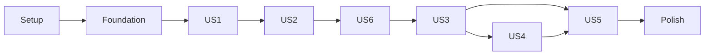

# Tasks: 楽譜の共同メンテナンスとMIDI練習・リズムゲーム

**Input**: `specs/001-score-practice-platform/`のspec・plan・research・data-model・contracts・quickstart。
**Prerequisites**: [plan.md](plan.md)、[spec.md](spec.md)、[data-model.md](data-model.md)。
**Tests**: 仕様の受け入れシナリオと成功基準、憲章IVに必要な回帰・契約・実DB検証を含む。
**Organization**: P1=US1/US2/US6、P2=US3/US4、P3=US5。番号は仕様のUS番号を保持する。

## Format: `[ID] [P?] [Story] Description`

各タスクは未完了チェックボックス、連番ID、該当ストーリー、対象パスを持つ。
[P]は同一フェーズ内で共通前提を終えた後、独立ファイルへ並行着手できるものだけ。
記載パスは既存または作成予定。新規プロジェクトや他のスキルを導入するタスクはない。

## Path Conventions

リポジトリルート基準のsrc/、prisma/、scripts/、docs/を使用する。
DB migrationのファイル名はPrismaが実行時に生成するため、タスクでは保存先ディレクトリを指定する。
schema.prisma/共通サービスを変更するタスクは直列で実行する。

## Phase 1: Setup (Shared Infrastructure)

**Goal**: 既存環境をNode.js 22と専用の検証環境に揃える。

**Independent Test**: 依存関係の導入、既存テスト、Prisma生成を確認し、既存失敗は記録する。

- [x] T001 Dev ContainerをNode.js 22へ揃え、CI・lockfileと既存依存の互換を確認する — .devcontainer/devcontainer.json、package.json、package-lock.json、.github/workflows/test.yml
- [x] T002 [P] 秘密値を含まないOAuth・DB・IMPORT_PREVIEW_SECRETの設定例と運営セットアップ手順を記載する — docs/development.md
- [x] T003 [P] 専用PostgreSQLで2接続の競合検証を実行できるVitest設定とDB初期化/終了処理を用意する — vitest.integration.config.mts、src/server/testing/database.ts
- [x] T004 既存npm test -- --runの結果と、型検査・lint・buildの基準状態を記録する — specs/001-score-practice-platform/validation.md

**Checkpoint**: 基盤/検証の結果を確認してから次のフェーズへ進む。

## Phase 2: Foundational (Blocking Prerequisites)

**Goal**: 認証、基礎スキーマ、認可、既存データ保全を全ストーリー共通の基盤として用意する。

**Independent Test**: 未管理Scoreを公開せず、本人識別と初版/数値ID/JSONを保全できる。

- [x] T005 Gitコミット索引のScoreRevision、Git保存キー/採用OID/世代/同期状態のRepositoryと基礎モデルを追加し、既存Score.dataは移行元だけ保全、新版JSONはGitから読む — prisma/schema.prisma、prisma/migrations/（Prismaで生成するmigration.sql）
- [x] T006 Git CLIと永続保存領域を検証環境/サーバー前提へ追加し、アプリソースのGitと分離する — .devcontainer/devcontainer.json、docs/development.md
- [x] T007 shellなしのGit CLIアダプターでbare repo・blob/tree/commit・旧OID比較ref更新・固定path読取を実装し、hook無効化/引数/パス/期限を検証する — src/server/git-store.ts、src/server/git-store.test.ts
- [x] T008 GitHub OAuthとdatabaseセッションを設定し、next-authのsignIn/signOutと組み込みログイン・エラー画面へヘッダーから接続する。認証主体/状態を取得し、ログアウト時の本人キャッシュ破棄と再アクセス拒否を検証する — src/auth.ts、src/server/auth.ts、src/components/header.tsx、src/server/auth.test.ts、src/components/header.test.tsx
- [x] T009 既存ユーザーIDへ運営権限を付与する管理用CLIを作り、理由を監査し、公開Actionで自己昇格できないことを検証する — scripts/grant-operator.ts、src/server/auth.test.ts
- [x] T010 一覧/閲覧/編集/管理用の認可を中央化し、PRIVATE/INVITED/PUBLICとINVITED/ALL_USERSの現在値をDBで確認する — src/server/authorization.ts
- [x] T011 MutationReceiptを(actorId,operation,key)一意で保存し、payloadHash・処理状態・確定resultを持たせる。業務更新と同時保存、同内容再送/異内容CONFLICT/同時claim/削除tombstoneを検証する — prisma/schema.prisma、src/server/contracts.ts、src/server/idempotency.ts、src/server/idempotency.test.ts
- [x] T012 構造と音楽値を検証する標準Sheet JSONスキーマを定義し、値オブジェクトを再利用して不正数値・参照を拒否する — src/s-core/models/import/score-schema.ts
- [x] T013 GitPublicationJobとreceipt復旧項目を基盤schemaへ追加し、対象/基準/準備OID/ref/stage/leaseを保存する。原本bytesは保存しない — prisma/schema.prisma、src/server/git-operation.ts
- [x] T014 共通のobject準備→DB採用→ref同期エンジンを作り、移行/初版は運営認可で実行し、編集案/信頼度モデルを必要としない操作種別境界を定義する — src/server/git-acceptance.ts
- [x] T015 GitPublicationJobの排他回復workerを実装し、main同期済みなら再利用、未知OIDはREPAIR_REQUIRED、Git書込をDB transactionの外で実行する — src/server/git-publication.ts、scripts/recover-git-publications.ts
- [x] T016 準備ref後/DB項目記録前/DB確定後/ref同期後の停止と再起動を実Git/DBで検証し、元ファイルなしで回復、objectなしは再送待ち、移行の二重反映を防ぐ — src/server/git-acceptance.test.ts、src/server/git-publication.test.ts
- [x] T017 既存Scoreの件数/ID/JSONハッシュを保全し、Git初版objectと版索引を作成する。所有者不明は隔離し、運営割当を監査する — scripts/migrate-legacy-scores.ts、src/server/legacy-score-assignment.ts
- [x] T018 移行前後の同一性と未管理データの隔離、他者アクセス拒否を実DBで検証する — src/server/legacy-score-assignment.test.ts、src/server/authorization.test.ts

**Checkpoint**: 基盤/検証の結果を確認してから次のフェーズへ進む。

## Phase 3: User Story 1 - 楽譜を見て内容を確認する (Priority: P1) 🎯 MVP

**Goal**: 認可された楽譜をMIDI接続なしで閲覧する。

**Independent Test**: fixtureと表示の音高・音価・休符・拍子・調号・テンポを照合し、権限なし/未管理は本文を返さない。

- [x] T019 [P] [US1] 可視スコープ・過去版・非公開と未管理のNOT_FOUNDを検証する — src/server/score-reader.test.ts
- [x] T020 [P] [US1] 既存fixtureの非破壊表示、MIDIなしの閲覧、空/失敗状態を検証する — src/components/score-viewer.test.tsx
- [x] T021 [US1] DB索引で版を認可してからGitの固定pathを読んで一覧/本文DTOを返し、任意OID読取を拒否する — src/server/score-reader.ts
- [x] T022 [US1] home・score一覧/詳細・rythme既存経路の直接Prisma読取を認可済みサービスへ統合する — src/app/page.tsx、src/app/score/page.tsx、src/app/score/[id]/page.tsx、src/app/score/[id]/rythme/page.tsx
- [x] T023 [US1] 既存ShowScore/ScoreViewerを版DTOから表示し、読み込み・非公開・空状態と利用不能の理由を示す — src/components/show-score.tsx、src/components/score-viewer.tsx

**Checkpoint**: 次のストーリーへ進む前に上記の独立検証を通す。

## Phase 4: User Story 2 - 複数人で楽譜の間違いを修正する (Priority: P1)

**Goal**: 編集案、版、共有権限と信頼度基準による原子的なマージを提供する。

**Independent Test**: 2人の同版編集・信頼度の閾値境界・招待権限・自己加点・運営設定変更を実DBで照合する。

- [x] T024 [P] [US2] 信頼度の3要素・算出設定版・未設定・自己評価/自己マージと重複イベント、重みが1以外・clamp状態からの目標値調整を検証する — src/server/trust.test.ts
- [x] T025 [P] [US2] 同時マージ・権限取消/設定変更競合・rollback・再送を専用DBの2接続で検証する — src/server/proposals.test.ts
- [x] T026 [P] [US2] 共有スコープ・メンバー/最後の管理者制約・原本不変の提出契約を検証する — src/server/repositories.test.ts
- [x] T027 [US2] Git提案OID/refを持つEditProposal、MergeRecord、信頼度の各モデルとUserTrustState(userId unique,inputVersion)を追加する。提案は提出後不変、採用索引は(scoreId,number)一意、実績sourceIdは一意 — prisma/schema.prisma、prisma/migrations/（Prismaで生成するmigration.sql）
- [x] T028 [US2] research.mdの宣言的clamp式を純粋に実装し、wAdminは正・その他重み非負・全値有限・初期値/基準値が上下限内を検証する — src/server/trust-calculation.ts
- [x] T029 [US2] 運営だけの設定有効化・research.mdのA_new逆算による理由付き目標値調整と、1評価者/対象1件の更新を実装し、実績/評価/調整と同一transactionでUserTrustState.inputVersionを増やす。キャッシュはruleIdと入力版一致時だけ利用する — src/server/trust.ts
- [x] T030 [US2] リポジトリ作成・スコープ変更・登録ユーザーへの招待/役割/マージ権限の付与取消を実装し、accessVersionを増やす — src/server/repositories.ts
- [x] T031 [US2] 新規楽譜と編集案をGitの固定treeから作り、baseRepositoryCommitOid/Score基準版/proposalCommitOidを保存する。下書きだけ編集可、提出後不変、却下/取下げを監査する — src/server/proposals.ts
- [x] T032 [US2] 共通Git採用エンジンへ編集案の現在ACL/信頼度/基準OID判定と、状態・MergeRecord・実績/入力版更新を接続する。共通基盤と回復workerは再実装しない — src/server/merge-proposal.ts
- [x] T033 [US2] 準備object後/DB確定後/main更新後の故障と再送、同時採用、権限/設定変更を実Git+実DBで検証し、採用と信頼度加点が一度だけになることを確認する — src/server/git-publication.test.ts、src/server/proposals.test.ts
- [x] T034 [US2] 認可付きrepository/proposal/trust ActionsとarchiveScoreを実装し、無認証物理削除と旧create経路を置き換える — src/app/actions/repositories.ts、src/app/actions/proposals.ts、src/app/actions/trust.ts、src/app/score/create/page.tsx、src/app/score/[id]/page.tsx
- [x] T035 [US2] 音高・音価・開始位置・休符・拍子・調号・テンポを編集する下書き、差分、履歴、競合時の再提出と再試行を統合する — src/components/score-edit.tsx、src/components/proposal-editor.tsx、src/app/repositories/[id]/proposals/[proposalId]/page.tsx
- [x] T036 [US2] 閲覧/編集/マージ権限を区別したメンバー管理、リポジトリ作成/一覧、現在の信頼度と不足理由を表示する — src/app/repositories/page.tsx、src/components/repository-members.tsx
- [x] T037 [US2] 運営設定・直接調整の確認画面と本人の信頼度根拠/他者評価入力を実装し、固定本番値を自動登録しない — src/app/admin/trust/page.tsx、src/components/user-trust.tsx

**Checkpoint**: 次のストーリーへ進む前に上記の独立検証を通す。

## Phase 5: User Story 6 - 外部の楽譜を取り込んで活用する (Priority: P1)

**Goal**: 形式別変換、保持/整列のプレビュー、診断付き保存と元ファイル解放を提供する。

**Independent Test**: 認定形式の同曲を比較し、変換の欠落と整列境界・切替・元データ非永続化・署名改ざんを確認する。

- [x] T038 [P] [US6] 認定MusicXML/SMF/Core JSON/Sheet JSON、未対応/不正・欠落・連打・整列境界のfixtureと期待値を用意する — src/s-core/fixtures/import/manifest.json
- [x] T039 [P] [US6] プレビュー/保存の署名・期限・主体・保存前修正/再署名・診断不正削除・警告確認・権限・元bytes非永続化と終了/中止解放を検証する — src/server/score-import.integration.test.ts、src/server/import-preview-token.test.ts、src/server/import-revalidate.test.ts
- [x] T040 [US6] ImportMetadata/ConversionIssue/RevisionValidationを追加し、完全Sheetとconverted-partial-v1を識別するZod候補/診断型を作る。ImportPreview（永続化しない）の制約:「変換中だけ。元bytesと整列前コピーをDBへ保存しない」。ImportMetadataの制約:「保存された変換設定。sourceNameは表示用でパスではない」。ConversionIssueの制約:「WARNING/BLOCKING。未解決BLOCKINGは演奏不可」。RevisionValidationの制約:「サーバー算出。クライアントの可否を信用しない」 — prisma/schema.prisma、prisma/migrations/（Prismaで生成するmigration.sql）、src/s-core/models/import/contracts.ts
- [x] T041 [US6] 拡張子/MIME/内容を照合する形式検出と既定補完の診断、構造不正FATAL・演奏欠落BLOCKING・表示欠落WARNINGを実装する — src/s-core/models/import/detect-format.ts、src/s-core/models/import/diagnostics.ts
- [x] T042 [P] [US6] MusicXML4.0 partwiseのraw XML/MXL入口、container内rootfile・展開量検査、外部実体/パス拒否と正しい声部/和音/タイ/連符/メタ変換を実装する — src/s-core/models/import/musicxml.ts、src/s-core/models/files/musicxml/extensions/to-sheet.ts
- [x] T043 [P] [US6] SMF0/1 PPQNのparserを修正し、running-status/可変長メタ/2 \*\* item拍子分母/イベント分岐、track-channel-pitch対応とメタ時系列を正規化する — src/s-core/models/files/standard-midi-file/parser.ts、src/s-core/models/files/standard-midi-file/extensions/to-core.ts
- [x] T044 [P] [US6] CoreパラメーターJSONとSheet export JSONを明示判定/検証し、元の複製から非破壊変換し、混合/任意JSONを拒否する — src/s-core/models/import/json.ts
- [x] T045 [US6] PRESERVE/QUANTIZEと6グリッドを有理数比較で実装し、onset/duration最近傍・同差小さい側・長さ補正警告と変更差分を返す — src/s-core/models/import/quantize-midi.ts
- [x] T046 [US6] 独立した元bytesの複製から共通変換を構成し、未対応バージョン/構造拒否、known候補と欠落参照、converterVersionを返す — src/s-core/models/import/convert.ts
- [x] T047 [US6] 形式/量/音符数/10秒の上限と中止可能ワーカー、同時1要求/主体制限、後片付けを実装し、元bytesをdiskや永続キューへ出さない — src/server/import-worker.ts、src/server/import-limits.ts
- [x] T048 [US6] 認証付きmultipartプレビューRoute Handlerとactor/候補/issues/metadataハッシュ・30分期限の署名をNode.js標準cryptoで実装し、保存前修正を再検証して診断と新署名を返す入口を追加する — src/app/api/score-import/preview/route.ts、src/app/api/score-import/revalidate/route.ts、src/server/import-preview-token.ts、src/server/import-revalidate.ts
- [x] T049 [US6] saveImportで署名と権限/警告確認を検証し、候補・設定・診断だけをGit treeの新規版または編集案へ保存しDBには索引を保持、原本上書きと二重保存を防ぐ — src/server/score-import.ts、src/app/actions/score-import.ts
- [x] T050 [US6] 修正されたフィールドを検証して新版だけの利用可否を再算出し、未解決BLOCKINGは確認だけで解除せず、初版/編集案/マージ経路へ統合する — src/server/revision-validation.ts、src/server/proposals.ts、src/server/merge-proposal.ts
- [x] T051 [US6] 対応表・変換設定・警告・known部分/欠落マーカーのプレビューと修正を統合し、元Fileはメモリ内だけ保持、切替は元から再変換し保存/中止/離脱で解放する — src/components/form-create-score.tsx、src/components/import-preview.tsx、src/s-core/models/browser/importer.ts
- [x] T052 [US6] 変換契約の全形式、MusicXML演奏順の欠落、MIDI境界/チャンネル/既定補完と元データ復帰をfixtureで検証する — src/s-core/models/import/convert.test.ts、src/s-core/models/import/quantize-midi.test.ts
- [x] T053 [US6] 警告保存とBLOCKINGによる練習開始不可、修正版の再検証、署名改ざん/期限切れとブラウザーcleanupを統合検証する — src/components/import-preview.test.tsx、src/server/score-import.integration.test.ts、src/s-core/models/import/ties.test.ts

**Checkpoint**: 次のストーリーへ進む前に上記の独立検証を通す。

## Phase 6: User Story 3 - MIDI演奏を記録して苦手な箇所を知る (Priority: P2)

**Goal**: 正確な基準時刻で演奏を記録し、音高・早遅・小節別の分析を表示する。

**Independent Test**: 誤音/弾き逃し/余分な音、テンポ変化、タイ、時刻境界、機器中断を既知の記録で照合する。

- [x] T054 [P] [US3] 期待タイムラインの範囲端/タイ/休符/テンポ変化と対応付けの±150ms境界・同差・入力一回消費・0件nullを検証する — src/s-core/models/practice/timeline.test.ts、src/s-core/models/practice/matching.test.ts
- [x] T055 [P] [US3] 選択機器・channel/pitch/velocity・時刻・許可拒否/遅延完了・dispose/切断・resume待機を検証する — src/s-core/models/browser/midi-recorder.test.ts、src/s-core/models/browser/practice-clock.test.ts
- [x] T056 [US3] PracticeSession/PerformanceEventBatch/EvaluationResult/EvaluationRuleVersionを追加し、録音イベントの型と条件を契約どおり検証する。PracticeSessionの制約:「(userId,clientSessionId)一意。本人のみ。機器IDは公開・認証用途に使わない」。PerformanceEventBatchの制約:「複合一意、同じindexで異なる内容は競合。整数相対時刻で保存」。EvaluationResultの制約:「サーバー再評価。入力と版の参照を固定。クライアント値は保存の正ではない」。EvaluationRuleVersionの制約:「不変。初期値はspecの仮定を使用。信頼度ルールと別」 — prisma/schema.prisma、prisma/migrations/（Prismaで生成するmigration.sql）、src/s-core/models/practice/contracts.ts
- [x] T057 [US3] 純粋なテンポ積分/テンポ比/範囲原点と期待音を作り、休符とタイ継続を新打鍵から除外する — src/s-core/models/practice/timeline.ts
- [x] T058 [US3] 正音優先→誤音→弾き逃し/余分な音の安定順マッチングと小節別音高正確率・時刻平均ずれ・nullを実装する — src/s-core/models/practice/matching.ts、src/s-core/models/practice/analyze.ts
- [x] T059 [US3] sysexなしの選択機器記録とNOTE_ON/OFF正規化・sequence/整数µs・FIFO離鍵、中断状態と購読cleanupを実装する — src/s-core/models/browser/midi-recorder.ts
- [x] T060 [US3] resume完了後のperformance/出力時計原点、getOutputTimestampとfallback、正の遅延を差し引く補正を再生タイムラインと共有する — src/s-core/models/browser/practice-clock.ts、src/s-core/models/browser/audio/controller.ts
- [x] T061 [US3] CREATED→RECORDING→COMPLETED/INTERRUPTEDの制御とトラック/小節/テンポ/補正選択を実装し、BLOCKING・空の範囲では開始しない — src/s-core/models/browser/practice-session.ts、src/components/practice-controls.tsx
- [x] T062 [US3] サーバーで版の可否・条件・イベント上限を検証して純粋評価器で再評価し、clientSessionId/バッチ再送は同内容だけ許可する — src/server/practice.ts、src/app/actions/practice.ts
- [x] T063 [US3] 基準再生・記録中/中断状態と音別/小節別分析を既存viewer/playerと統合する — src/app/score/[id]/practice/page.tsx、src/components/practice-analysis.tsx
- [x] T064 [US3] サーバーのBLOCKING拒否、元版/条件固定、改ざんスコア不採用、未完了離鍵と同じ入力3回の一致を検証する — src/server/practice.test.ts、src/components/practice-controls.test.tsx

**Checkpoint**: 次のストーリーへ進む前に上記の独立検証を通す。

## Phase 7: User Story 4 - 自分の記録と練習の進歩を見る (Priority: P2)

**Goal**: 本人の履歴、条件別自己ベストと達成を保存し、削除後も整合を保つ。

**Independent Test**: 同条件の2結果、再ログイン、再送、削除、中断除外、他者記録不可を照合する。

- [x] T065 [P] [US4] 比較条件ハッシュ・同率比較/null・再送/削除集計・権限喪失後の本人要約と楽譜本文非公開を検証する — src/server/practice-history.test.ts
- [x] T066 [P] [US4] 履歴画面の条件表示・自己ベスト・中断・削除確認と非公開状態を検証する — src/components/practice-history.test.tsx
- [x] T067 [US4] Achievementと条件ハッシュ索引を追加する。Achievementの制約:「最初の完了・自己ベスト更新の表示用。同じ完了再送で増やさない」 — prisma/schema.prisma、prisma/migrations/（Prismaで生成するmigration.sql）
- [x] T068 [US4] 版/モード/トラック/範囲/テンポ/ルール/補正をcomparisonKeyにし、練習正確率→平均ずれ、ゲームscore、同率先着と中断除外で集計する — src/server/practice-history.ts
- [x] T069 [US4] 本人だけのlist/read/deleteを実装し、結果/入力削除と残る記録の完了数・ベスト・達成を同時再計算する — src/app/actions/practice-history.ts、src/server/practice-history.ts
- [x] T070 [US4] 履歴/個別結果と完了回数・自己ベスト通知を表示し、再ログイン後も保持、ログアウト時は本人データのclient cacheを消す — src/app/practice/history/page.tsx、src/app/practice/[id]/page.tsx、src/components/practice-history.tsx

**Checkpoint**: 次のストーリーへ進む前に上記の独立検証を通す。

## Phase 8: User Story 5 - 音高・和音を要求する難しいリズムゲームに挑戦する (Priority: P3)

**Goal**: 厳密な音高/和音/時刻判定とコンボ、版付きスコアを提供する。

**Independent Test**: 最高判定/通常/失敗・和音欠落/余分音、100/0点、同一入力3回を照合する。

- [x] T071 [P] [US5] ±30/60ms±1µs・和音worst評価・余分音の所属/コンボ順序・得点clamp・同じ入力3回をfixtureで検証する — src/s-core/models/practice/game-evaluation.test.ts
- [x] T072 [P] [US5] 判定条件の事前表示、仮判定/確定結果、中断時の正式スコア非採用を検証する — src/components/rhythm-game.test.tsx
- [x] T073 [US5] 同onset和音と最悪構成音評価、欠落/誤音/余分音の失敗、100\*(P+0.5G-X)/Nと時刻順コンボを純粋に実装する — src/s-core/models/practice/game-evaluation.ts
- [x] T074 [US5] ゲームルールの版を保存し、サーバー再評価とmode=GAMEの履歴/ベスト/達成へ統合する — src/server/practice.ts、src/server/practice-history.ts、prisma/seed.ts
- [x] T075 [US5] 既存rythme画面を契約に合わせ、開始前の判定条件・ライブ暫定判定・コンボ・終了結果と自己ベストを表示する — src/app/score/[id]/rythme/page.tsx、src/components/rhythm-game.tsx
- [x] T076 [US5] game開始/保存のBLOCKING拒否、完了再送/中断除外と満点/無演奏をサーバーから画面まで検証する — src/server/game-session.test.ts、src/components/rhythm-game.test.tsx

**Checkpoint**: 次のストーリーへ進む前に上記の独立検証を通す。

## Phase 9: Polish & Cross-Cutting Concerns

**Goal**: 全仕様の検証と運用前提を整え、性能・実機の証跡を残す。

**Independent Test**: quickstartのSC-001〜013が確認でき、構文・型・回帰・buildと運用入力が揃う。

- [x] T077 全操作のキーボード到達・ラベル・色以外の判定説明、保存失敗/再試行/未保存データと機密ログを横断確認する — src/components/import-preview.tsx、src/components/practice-controls.tsx、src/components/rhythm-game.tsx、specs/001-score-practice-platform/validation.md
- [x] T078 暫定規模/環境で30回の分析/一覧/変換計測を行い、p95/最大メモリと上限拒否を記録し、必要時のみ索引/走査を改善する — scripts/benchmark-score-practice.ts、specs/001-score-practice-platform/validation.md
- [ ] T079 MIDI実機・非対応ブラウザー・拒否/切断/背景化/再接続と音声cleanupを確認し、初見5人中4人の記録/苦手小節特定を検証する — specs/001-score-practice-platform/validation.md
- [x] T080 専用DBを含むテスト、npm test -- --run・npx tsc --noEmit・変更箇所lint・npm run buildを実行し、結果と制限を記録する — .github/workflows/test.yml、specs/001-score-practice-platform/validation.md
- [x] T081 採用版/提案/練習参照/準備objectの保持ref・GC、maintenance gate下のDB/Git組バックアップ/manifest/全OID照合と復旧を実装・検証する — scripts/backup-score-git.ts、scripts/verify-score-git.ts、src/server/git-retention.integration.test.ts、src/server/maintenance-gate.ts
- [x] T082 運営付与/秘密設定/移行確認/数値有効化と対応形式・制限・元ファイル再アップロードの手順を更新する — README.md、docs/development.md、specs/001-score-practice-platform/quickstart.md

**Checkpoint**: 基盤/検証の結果を確認してから次のフェーズへ進む。

## Dependencies & Execution Order

Setup → Foundational → US1 → US2 → US6 → US3 → US4 → US5 → Polishを標準実行順とする。
全ストーリーは基盤完了が前提。各フェーズ内はテスト/モデル/純粋処理→サービス→Action/画面→統合検証。
テスト項目を先に定義して未実装の挙動を再現し、実装後に同じ検証を通す。

US1は既存fixture/運営割当Scoreだけで価値を提供でき、他ストーリーを必要としない。
US2はfixture楽譜で検証でき、US6のインポートを必要としない。
US6はUS2の作成/編集案/マージ経路を利用するが、US3〜5の実装を待たず変換・保存・制限を検証できる。
US3は保存済み楽譜で練習分析を単独検証する。US4はUS3の記録を使い、ゲームなしで履歴を検証できる。
US5はUS3の時刻/評価基盤とUS4の個人記録を再利用する。意図的な依存を隠さない。
異なるストーリーのschema.prisma・共通Actionの変更を並行して行わない。
US6の形式変換器とUS3の純粋タイムラインは契約確定後に先行開発可能だが、統合完了は上の順序に従う。

## Parallel Examples by User Story

- US1: T019 と T020 を同フェーズの共通前提完了後に並行実行。実装サービスとの書込ファイル競合なし。
- US2: T024 と T025 と T026 を同フェーズの共通前提完了後に並行実行。実装サービスとの書込ファイル競合なし。
- US6: T038 と T039 と T042 と T043 と T044 を同フェーズの共通前提完了後に並行実行。実装サービスとの書込ファイル競合なし。
- US3: T054 と T055 を同フェーズの共通前提完了後に並行実行。実装サービスとの書込ファイル競合なし。
- US4: T065 と T066 を同フェーズの共通前提完了後に並行実行。実装サービスとの書込ファイル競合なし。
- US5: T071 と T072 を同フェーズの共通前提完了後に並行実行。実装サービスとの書込ファイル競合なし。

## Implementation Strategy

**MVP First**: Setup・Foundational・US1を完成し、認可された既存楽譜をMIDIなしで表示できる状態を最小到達点とする。
次の実用的な到達点はUS2+US6で、修正と外部形式の活用を提供する。その後US3/US4、最後にUS5を追加する。
各Checkpointで前の機能の回帰を確認する。公開は別途依頼された場合だけ行い、ここでは実装・検証を準備する。

## Requirement Coverage

| Requirement         | Story / phase                       |
| ------------------- | ----------------------------------- |
| FR-001              | US1                                 |
| FR-002〜005、FR-017 | US2                                 |
| FR-006〜010         | US3                                 |
| FR-011〜013         | 基盤の認証 + US4、記録保存はUS3     |
| FR-014〜015         | US5                                 |
| FR-016              | 全ストーリーのエラー・失敗試験      |
| FR-018〜024         | US6                                 |
| SC-001/002/007/008  | US1/US2、DB・権限検証               |
| SC-003/004          | US3、Polishの実機・初見ユーザー検証 |
| SC-005              | US4                                 |
| SC-006              | US5                                 |
| SC-009〜013         | US6                                 |

## Notes

認証はnext-auth、検証はZod、DBはPrisma、署名は標準cryptoを優先し、同じ基盤を自作しない。

数値設定のテスト値を本番へ自動適用しない。元ファイルを保存しない制約と、練習のMIDI記録保存を区別する。
生成コードは直接編集せず、schema変更後にPrisma生成を行う。
未管理Scoreの所有者を捏造せず移行確認を監査する。完了を示すチェックは実装/検証後にだけ付ける。

Git/DB間の停止点はcontracts/git-versioning.mdを実装の正とする。
新規保存・編集案・採用・archiveの全経路でこのプロトコルを利用し、GitとDBの単一transactionを主張しない。

基盤内はschema/認証/認可/receipt→Git操作記録→共通採用→回復worker→停止点検証→移行の順。US2は共通採用へ業務規則を接続する。
