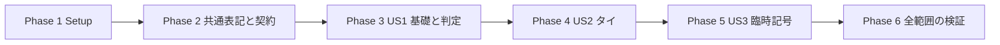

# Tasks: 楽譜描画の基礎回帰・タイ・臨時記号

**Input**: `specs/008-extend-score-notation/`

**Prerequisites**: [plan.md](plan.md)、[spec.md](spec.md)、[research.md](research.md)、[data-model.md](data-model.md)、[記譜契約](contracts/notation.md)、[fixtures 契約](contracts/fixtures.md)、[検証手順](quickstart.md)。憲章 v1.3.0 に従う。

**Tests**: 利用者と仕様が fixtures・回帰検証を明示要求しているためテストタスクを含む。各ストーリーの失敗テストを先に作成し、対象実装後に成功を確認する。文書生成の現段階では実装・アプリテストは行わない。

**Organization**: US1=P1 基礎記号確認、US2=P1 タイ、US3=P2 臨時記号。全て必須。MVP は最初の提供単位であり、US2/US3 の省略を意味しない。

## Format and Paths

タスク形式は `- [ ] Tnnn [P?] [USn?] 説明とパス`。パスはリポジトリルート基準。新規ファイル名も以下で固定する。`[P]` は該当 phase の開始後、他の `[P]` と別ファイルで進められる作業を示す。ストーリー間は共有ファイルのため直列に進める。

## Phase 1: Setup

**Goal**: 既存構成を維持し、対象と検証環境を固定する。

- [X] T001 既存入力・処理段階・未対応と実表示未確認を区別し、FR-001 の対応状況と後続候補を specs/008-extend-score-notation/investigation.md で再確認・更新する。

- [X] T002 Node 22、既存依存、Prisma 生成、Git、専用 TEST_DATABASE_URL（DB名末尾 _test）、Bravura の確認方法を specs/008-extend-score-notation/quickstart.md に実環境に合わせて記録する。新規依存・DB migration を追加しない。

**Checkpoint**: この phase の対象条件と検証記録を確認して次へ進む。

## Phase 2: Foundational

**Goal**: 全ストーリーで共有する表記保持と fixture 契約を実装する。

**Independent Test / Gate**: この phase を完了してから各ストーリーの実装を始める。

- [X] T003 [P] 共通表記の境界テストを src/s-core/models/sheet/notation/schema.test.ts に追加する。「step: A..G, octave: 整数 -1..9, alter: 整数 -2..2」「結果の演奏音高は0..127」、明示記号5種、任意 boolean、タイの未指定と空配列、number 境界、休符、不正な整合性を検証し、実装前の失敗を確認する。

- [X] T004 [P] manifest と結果契約のテストを src/s-core/models/fixtures/manifest.test.ts に追加する。version=1、一意 fixture/assertion ID、主対象1つ、非空 assertions、format 4種、stage 6種、selector、固定境界レイアウト、不正 enum を検査する。 expectedOutcome=render/reject、requiredStages は重複しない非空配列、reject の rejectionStage=import/persisted、stage 別の適用制約、visualChecklist の安定 ID、Run の識別値も検査する。

- [X] T005 共通 Zod と型を src/s-core/models/sheet/notation/schema.ts に実装する。notatedPitch は「{ step: A..G, octave: 整数 -1..9, alter: 整数 -2..2 }」、explicitAccidental は「{ kind: sharp/flat/natural/double-sharp/double-flat, cautionary?: boolean, parentheses?: boolean }」、visualTies は「{ type: start/stop/continue, number?: 整数1..16, placement?: above/below, orientation?: over/under }」「visualTies 最大32件／音符」。全項目任意、同種同番号の重複は拒否する。

- [X] T006 共通表記を src/s-core/models/import/score-schema.ts と src/s-core/models/import/contracts.ts の完全／不完全候補へ追加する。「(octave + 1) * 12 + stepSemitones + alter === pitch」、明示記号と alter の一致、「休符は音名・臨時記号・タイを持てない」を検証し、不完全候補は「pitch が null の間、整合性比較を保留する」。

- [X] T007 任意表記項目を src/s-core/models/sheet/note.ts の constructor/serialize/import に通し、src/s-core/models/import/promote-partial.ts の notation 付き／Core fallback の両経路で stem/beam を含め保持する。src/s-core/models/import/promote-partial.test.ts と src/s-core/models/sheet/notation/roundtrip.test.ts で欠落を防ぎ、旧データに default を永続追加しない。

- [X] T008 src/s-core/models/fixtures/manifest.ts に Zod の Manifest v1・Result v1 を実装する。assertion kind は count/absent/value/relativePosition/tieEndpoints/bounds、stage は import/roundtrip/persisted/document/svg/visual、status は pending/pass/fail/error/skipped、処理状態 loading/rendered/error は独立とする。結果は fixtureId/assertionId/stage/expected/actual/message を保持する。 expectedOutcome/requiredStages/rejectionStage と VisualRun/VerificationRun（fixtureId・sourceHash・expectationHash・layout・rendererRevision・executedAt・results、visual は browser/reviewer も必須）を契約どおり検証し、reject に描画成功を強制しない。

**Checkpoint**: 共通基盤の成功を確認して次へ進む。

## Phase 3: User Story 1 — 基礎記号を小さな楽譜で確認する (P1, MVP)

**Goal**: 1主条件の fixtures と意味に基づく判定・一覧を提供する。

**Independent Test / Gate**: 4分音符の種類・数・五線位置を判定し、符頭欠落や不要な符幹・旗を不合格にする。生成完了と検証合格・未検証を区別する。

- [X] T009 [P] [US1] 描画判定と集計の契約テストを src/s-core/models/fixtures/evaluate.test.ts に追加する。誤 glyph・欠落・位置違い・bounds だけの検査・未知 selector を区別し、required stage の pending/skipped/error が overall pass にならないことを検証する（FR-011–013）。 期待拒否の一致を pass、予期しない拒否・拒否されない結果を fail/error とし、非適用 skipped と必須段階未実施を区別する。

- [X] T010 [P] [US1] src/app/dev/load-score-fixtures.test.ts に専用 manifest 読み込み、存在しない入力、fixtures 配下外・symlink 逸脱、Core/MXL 既存入力保持、manifest 自体の誤取り込み防止を追加する。 verification-results.json と visual-results.json の欠落・破損・旧識別値・最新 fail 優先・未コミット実装／フォント変更による失効も検証する。

- [X] T011 [P] [US1] src/components/score-fixture-gallery.test.tsx に対象・期待値・処理完了と合否・不一致理由・未実施 visual/persisted、全ページの表示、debug/再配置/cleanup のテストを追加する。 render/reject の結果、非適用 skipped、証跡欠落と失効、最新失敗を表示するテストを含める。

- [X] T012 [US1] 判定器を src/s-core/models/fixtures/evaluate.ts と src/s-core/models/browser/evaluate-fixture-svg.ts に実装する。DOM 非依存の document 判定と SVG adapter を分離し、role/glyphName/source identity、正確な数、不在、staff space の位置関係、明示許容誤差、bounds を比較する。

- [X] T013 [US1] 段階別結果の集計を src/s-core/models/fixtures/results.ts に実装する。要求 assertion が全て pass の段階だけ合格とし、visual・persisted 未実施は pending/skipped。入力・期待値ハッシュ、レイアウト、ブラウザー、日時、確認者付きレビュー結果を検証し、変更前の記録を流用しない。 純粋な結果集計は同ファイル、Node 用の読み書き・現在ソース内容の SHA-256 fingerprint は scripts/lib/notation-report.ts、専用テストの段階別集約 runner は scripts/verify-notation-fixtures.ts に実装する。runner は --persisted でDB段階を追加し、実行単位の欠落を過去 pass で補完せず、失敗時は非0終了、verification-results.json を一時ファイルから rename で原子的に更新する。通常 npm test では証跡を暗黙更新しない。scripts/lib/notation-report.test.ts に集約・原子更新・ソース／フォント変更による失効のテストを追加する。対象 fingerprint のファイル集合は contracts/fixtures.md に従う。

- [X] T014 [US1] src/s-core/fixtures/notation/manifest.json を作成し、src/s-core/fixtures/notation/basic/ に全・2分・4分・8分・16分の符頭と休符を個別入力／期待値として追加する。既存 src/s-core/fixtures/core/ の入力はパス参照で再利用し、主条件ごとに安定 ID と由来を記載する（FR-003/009/014）。 正常条件は expectedOutcome=render と requiredStages を明示する。

- [X] T015 [US1] src/s-core/fixtures/notation/basic/ と src/s-core/fixtures/notation/manifest.json に付点、上下符幹・旗、連桁・前後フック、和音、上下加線、ト音・ヘ音、調号、拍子・変更、通常・終止小節線、複数譜表を1主条件ずつ追加する。種類・数・位置・不在条件を記録し、補助記号を主条件と混同しない。

- [X] T016 [US1] manifest を駆動する src/s-core/models/fixtures/notation.test.ts を追加し、基礎入力の document/SVG assertion と全主条件の欠落・誤種類・誤位置の対照結果を実行する。src/s-core/models/fixtures/coverage.test.ts でこの段階の US1/FR-003 と後続ストーリーの未実装範囲を区別する。

- [X] T017 [US1] 基礎 fixtures で検出した必須条件の描画欠落を src/s-core/models/engraving/note.ts、src/s-core/models/engraving/chord.ts、src/s-core/models/engraving/stave.ts、src/s-core/models/engraving/extensions/to-document.ts の該当箇所で修正し、src/s-core/models/engraving/extensions/to-document.test.ts に対象回帰を固定する（FR-003/017）。

- [X] T018 [US1] src/app/dev/load-score-fixtures.ts に notation manifest の明示 loader を追加する。fixtures 内の realpath を検証し、4入力形式を現行 converter に通す。固定 layout と期待値を渡し、旧 Core/MXL loader と入力 ID を維持する。 specs/008-extend-score-notation/verification-results.json と visual-results.json を検証して読み込み、fixtureId・sourceHash・expectationHash・layout・rendererRevision が現行値と一致する stage の最新結果のみ採用する。結果欠落は未検証、破損はエラー、失効は未検証。拒否専用入力は converter／描画を強制せず提示する。

- [X] T019 [US1] src/components/score-fixture-gallery.tsx に HeroUI を使った対象・期待値・段階別結果を追加する。Horizontal/Vertical/Page と fixture 固定寸法に従い全ページを描画し、旧 metadata なし入力は未検証とする。SVG の存在だけで合格にしない（FR-012）。 requiredStages に従い reject の期待拒否合格と非適用段階を表示し、読み込んだ実保存・目視結果だけを反映する。

- [X] T020 [US1] 開発専用 src/app/dev/notation/fixtures/page.tsx を追加して loader と gallery を接続する。production は notFound とし、src/app/dev/notation/fixtures/page.test.tsx で非公開を確認する。既存 /dev/core/fixtures と /dev/mxl/fixtures は継続する。

- [X] T021 [US1] src/s-core/models/fixtures/notation.test.ts と src/components/score-fixture-gallery.test.tsx の US1 条件を実行し、既存 src/s-core/models/browser/score-svg.test.ts、src/components/score-viewer.test.tsx も回帰確認する。結果を specs/008-extend-score-notation/validation.md に記録する。 scripts/verify-notation-fixtures.ts で非DB結果ファイルの生成から loader・gallery まで検証する。

- [ ] T022 [US1] 実ブラウザーで基礎の代表 fixtures の形状・Bravura・中央C位置・不要要素不在・debug・再レイアウトを確認し、入力／期待値ハッシュ付きの段階別結果を specs/008-extend-score-notation/visual-results.json に記録する。未確認項目は合格にしない。 visualChecklist ID、browser/reviewer、現在内容の rendererRevision と expectationHash も記録し、変更後は未検証へ戻ることを確認する。

**Checkpoint**: この phase の対象条件と検証記録を確認して次へ進む。

## Phase 4: User Story 2 — タイを保存後も正しく読む (P1)

**Goal**: 音楽的タイを変えず、視覚タイを正しく接続して全レイアウトへ表示する。

**Independent Test / Gate**: 同小節・小節越え・連鎖・和音の対象音のタイが、取り込みと実保存取得の前後で同じ端点へ描かれる。改行／ページの両片と visual-only の再打鍵不変を検証する。

- [X] T023 [P] [US2] src/s-core/models/import/musicxml-notation-ties.test.ts に note/tie と notations/tied の独立性、start/stop/continue、番号・上下、未指定／空配列、4版の保持、不完全候補の promotion、未対応形状の診断を実装前テストとして追加する。

- [X] T024 [P] [US2] src/s-core/models/sheet/notation/ties.test.ts に同小節・小節越え・連鎖・和音一部・声部／譜表／パート分離、番号、異名同音、端点欠落・重複・曖昧ユニゾン、既存時間許容誤差内の接続を追加する。

- [X] T025 [P] [US2] src/s-core/models/document/curve.test.ts と src/s-core/models/document/extensions/to-svg.test.ts に「kind=curve、role=tie」「geometry は staff space、全座標有限、bounds は塗りの全体を含む」、閉じた三次曲線帯と endpoint metadata のテストを追加する。

- [X] T026 [P] [US2] src/s-core/models/engraving/notation-ties.test.ts と src/s-core/models/browser/notation-ties-svg.test.ts に符頭端点・上下符幹・和音・加線・固定改行／改ページ、全ページ bounds と再配置不変の失敗テストを追加する。

- [X] T027 [P] [US2] src/server/score-notation.integration.test.ts にタイ正常条件の convertScore→signPreview→saveImport→readScore→Sheet→同一描画 assertion の検証を追加する。新規保存と既存譜への提案・マージ・再取得、旧資料、診断投影を含め、JSON 往復で代替しない（FR-004）。 実行した stage を runner の収集先へ出力し、--persisted の集約で取得できるようにする。

- [X] T028 [US2] src/s-core/models/import/musicxml.ts で ties を維持し visualTies を抽出・正規化する。未指定は musical fallback、明示空配列は表示抑止、continue は連鎖として保持する。let-ring・破線・任意原譜座標・方向矛盾は契約どおり表示診断し、音楽値へ変換しない。

- [X] T029 [US2] src/s-core/models/sheet/notation/ties.ts に索引による TieRelation 解決を実装する。identity は「trackId:noteId」、キーは track/stave/voice/pitch と任意 number、id は両端から安定生成、origin は visual/musical-fallback、placement は above/below。start pending→stop 接続／continue 終点兼始点、原則「start.end == end.start」。曖昧候補を選ばず、導出関係は永続化しない。

- [X] T030 [US2] src/s-core/models/import/diagnostics.ts に DISPLAY_TIE_UNRESOLVED/TIE_DISPLAY_MISMATCH の WARNING と AMBIGUOUS_TIE の BLOCKING を追加する。UNMATCHED_TIE を維持し、同キー pending の上書きを検出する。src/s-core/models/import/ties.test.ts と src/s-core/models/import/diagnostics.test.ts で再検証と stale 診断解決・警告確認による blocker 維持を検証する（FR-006/016）。

- [X] T031 [US2] src/s-core/models/document/curve.ts、src/s-core/models/document/element.ts、src/s-core/models/document/index.ts に DOM 非依存 Curve と両端・relationId・part=complete/outgoing/incoming の metadata を追加する。曲線は start/end・2本の三次曲線制御点・fill・bounds を保持する。

- [X] T032 [US2] src/s-core/models/document/extensions/to-svg.ts で Curve を閉じた path として描画し、既存 type/data-* と整合する relation／両端 identity／segment の属性を出力する。既存 glyph/line/rectangle を回帰確認する。

- [X] T033 [US2] src/s-core/models/engraving/notation/ties.ts と src/s-core/models/engraving/extensions/to-document.ts に符頭境界からの曲線生成を実装する。上下符幹、和音内の複数タイ、最小間隔・曲率・衝突回避を扱い、関係と描画片の identity を保つ。

- [X] T034 [US2] src/s-core/models/engraving/controller.ts、src/s-core/models/sheet/row.ts、src/s-core/models/engraving/extensions/to-document.ts で上下のタイ余白を row 高さへ反映してからページ割当する。改行／改ページは outgoing/incoming に分割し、再 layout で座標を再計算する。元の音楽情報は変更しない。

- [X] T035 [US2] src/s-core/fixtures/notation/ties/ に同小節、小節越え、3音連鎖、和音一部、声部・譜表・パート分離、番号、異名同音、visual-only、mismatch、欠落端点・曖昧ユニゾンの最小 XML/Sheet JSON 入力を追加し、src/s-core/fixtures/notation/manifest.json に保持・往復・persisted・document・SVG・visual の期待値と対照条件を登録する。 正常・表示警告付きの render と、期待エラーを確認する reject を分け、reject は rejectionStage と必要な requiredStages のみに assertion を登録する。

- [X] T036 [US2] src/s-core/fixtures/notation/ties/ と src/s-core/fixtures/notation/manifest.json に固定寸法の system-break/page-break、上下符幹・加線とのタイを各主条件で追加する。大きな入力の sizeReason を記載し、各対象群の MXL と MusicXML 2.0/3.0/3.1/4.0 共通表現の保持を src/s-core/models/import/musicxml-notation-ties.test.ts で検証する。

- [X] T037 [US2] src/s-core/models/fixtures/evaluate.ts と src/s-core/models/browser/evaluate-fixture-svg.ts に tieEndpoints と relation/segment selector の判定を追加し、src/s-core/models/fixtures/evaluate.test.ts で曲線欠落・誤端点・誤別声部・継続片欠落を不合格にする対照結果を検証する。

- [X] T038 [US2] src/s-core/models/practice/timeline.test.ts、src/s-core/models/practice/game-evaluation.test.ts、src/s-core/models/browser/audio/controller.test.ts に visual-only・fallback・連鎖・和音一部と音楽的 blocker の回帰を追加し、打鍵数・音高・開始位置・継続音価・利用可否が視覚情報で変わらないことを確認する（US2/AC4、SC-005）。

- [ ] T039 [US2] US2 の単体・SVG・DB統合テストを実行し、実際の取り込みプレビュー→保存→再表示と全正常タイの実ブラウザー形状・全ページ接続を確認する。specs/008-extend-score-notation/validation.md と specs/008-extend-score-notation/visual-results.json に結果を残し、未実施 persisted/visual を pass にしない。 runner の --persisted 出力を verification-results.json に生成し、loader から一覧へ伝わることと visual 記録の rendererRevision 一致を確認する。

**Checkpoint**: この phase の対象条件と検証記録を確認して次へ進む。

## Phase 5: User Story 3 — 臨時記号と音名表記を保持する (P2)

**Goal**: 異名同音・明示記号・小節状態を保持し、音高を変えず正しい五線位置と記号を表示する。

**Independent Test / Gate**: C♯/D♭、natural、ダブル記号、注意喚起・括弧が実保存取得後も同じ位置と表記となり、小節内反復・小節境界・声部共有・各分離条件を個別に検証する。

- [X] T040 [P] [US3] src/s-core/models/import/musicxml-accidentals.test.ts に元音名・5記号・注意喚起・括弧、4版、部分候補、unsupported／表記矛盾と演奏音高不明の区別を検証する失敗テストを追加する。

- [X] T041 [P] [US3] src/s-core/models/sheet/notation/accidentals.test.ts に調号・小節状態・自然化・小節リセット、声部共有、譜表／パート／オクターブ分離、同時矛盾の配列順不変、調号変更、タイ終点と次の独立打鍵の状態を検証する。

- [X] T042 [P] [US3] src/s-core/models/engraving/notation-accidentals.test.ts と src/s-core/models/browser/notation-accidentals-svg.test.ts に異名同音の五線位置、5 glyph、括弧、和音の列分離、幅計算・再描画・上下加線との組み合わせのテストを追加する。

- [X] T043 [US3] src/server/score-notation.integration.test.ts に元表記・明示記号・括弧の正常 manifest 全条件を保存・取得して同じ assertion を再実行するテスト、音名／pitch 矛盾の保存拒否と revision/Git の部分公開がないテストを追加する。 保存拒否 fixture は rejectionStage=persisted とし、converter に先に拒否させず実保存境界へ渡す。期待拒否と不変条件は合格、非適用描画は skipped として検証する。

- [X] T044 [US3] src/s-core/models/import/musicxml.ts に step/octave/alter と accidental の抽出を追加し、src/s-core/models/import/json.ts と src/s-core/models/import/promote-partial.ts の経路で保持する。原入力の矛盾は不正表記を完全候補に残さず警告して推定へ戻し、音楽値不明は既存 partial/BLOCKING に残す。

- [X] T045 [US3] src/s-core/models/sheet/notation/pitch.ts と src/s-core/models/sheet/note.ts に元の音名・オクターブ優先の五線位置と既存データ fallback を実装する。演奏 pitch を変えず、旧 JSON/MIDI に原譜表記を捏造・永続追加しない（FR-007/015）。

- [X] T046 [US3] src/s-core/models/sheet/notation/accidentals.ts に非永続 AccidentalDecision を実装する。キーは「track/stave/bar/step/octave」、同時刻を一括評価、明示優先、矛盾時は必要記号を各音へ出して後続状態を不確定とする。タイ越し終点は未明示なら再表示せず、次の独立打鍵の記号を省略しない（FR-008）。

- [X] T047 [US3] src/s-core/models/engraving/controller.ts と src/s-core/models/engraving/note.ts に幅計算前の臨時記号解決と5記号・括弧の glyph 生成を接続する。src/s-core/models/engraving/chord.ts で隣接和音の記号列と幅・間隔を確保し、繰り返し draw の累積を防ぐ。

- [X] T048 [US3] src/s-core/models/engraving/extensions/to-document.ts へ臨時記号・括弧を note identity 付きで出力し、src/s-core/models/import/diagnostics.ts で NOTATION_PITCH_MISMATCH と未対応表示の警告・再検証を扱う。完全表示の対象へ不要警告を出さない（FR-016）。

- [X] T049 [US3] src/s-core/fixtures/notation/accidentals/ と src/s-core/fixtures/notation/manifest.json に sharp/flat/natural/double-sharp/double-flat、enharmonic-spelling、explicit-cautionary、parentheses を1主条件ずつ追加する。import/roundtrip/persisted/document/SVG/visual と記号欠落・種類／位置違いの対照結果を記載する。 各正常 fixture に expectedOutcome=render と段階別 requiredStages を明記する。

- [X] T050 [US3] src/s-core/fixtures/notation/accidentals/ と src/s-core/fixtures/notation/manifest.json に repeat-in-bar、reset-next-bar、voice-sharing、staff/part/octave-isolation、simultaneous-conflict、key-change と小節越えタイ・次独立打鍵を独立条件で追加する。和音・加線・上下符幹との組み合わせは単独条件の後に登録する。

- [X] T051 [US3] src/s-core/models/import/musicxml-accidentals.test.ts と src/s-core/fixtures/notation/accidentals/ で4版共通表現・MXL・新旧 Sheet JSON の往復を検証し、src/s-core/models/fixtures/notation.test.ts の同一評価器で臨時記号全条件と対照結果を実行する。

- [X] T052 [US3] src/s-core/models/import/score-schema.test.ts、src/s-core/models/practice/timeline.test.ts、src/s-core/models/practice/game-evaluation.test.ts に旧データ・音名変更・明示記号追加の回帰を追加し、音楽値・打鍵・採点・利用可否と描画前後の元データ不変を検証する（FR-015/017）。

- [ ] T053 [US3] US3 の単体・SVG・DB統合テストを実行し、実際の取り込みプレビュー→保存→再表示と全正常臨時記号の実ブラウザー形状・位置・括弧を確認する。specs/008-extend-score-notation/validation.md と specs/008-extend-score-notation/visual-results.json にハッシュ付き結果を記録する。 runner --persisted の verification-results.json と rendererRevision 付き visual 記録を loader が採用することを確認する。

**Checkpoint**: この phase の対象条件と検証記録を確認して次へ進む。

## Phase 6: Polish & Cross-Cutting Concerns

**Goal**: 全範囲の互換性、網羅性、実行結果を確認する。

**Independent Test / Gate**: 全ストーリーの必須条件と SC-001–006 を満たした場合のみ完了。

- [X] T054 src/s-core/models/import/convert.ts の新変換のみ converterVersion=score-import-v3 に更新し、src/s-core/models/import/convert.test.ts と src/server/import-preview-token.test.ts で旧 v1/v2 の候補・有効署名を維持すること、署名確認前の補完がないこと、formatVersion と MIDI/JSON の音楽内容不変を検証する。

- [X] T055 src/s-core/models/fixtures/coverage.test.ts で FR-003 の各条件、US2/AC1–5、US3/AC1–4 を必須化し、全正常対象の required stage と全主条件の対照検証が欠けると失敗させる。specs/008-extend-score-notation/coverage.md に FR-001–017 と SC-001–006→fixture/assertion/task の対応を記録する。 coverage は expectedOutcome ごとの必須段階を検査する。reject は期待拒否と必要な保存不変、render は正常表示と必要な persisted/visual を要求する。

- [ ] T056 src/server/score-notation.integration.test.ts と src/server/score-import.integration.test.ts を全対象で実行し、保存・取得後の描画、提案・マージ、診断投影、認可・署名・不正入力の原子的拒否を確認する。環境不足は specs/008-extend-score-notation/validation.md に未検証として残す。 runner --persisted でも結果を収集し、期待拒否の合格と環境不足による未実施を別扱いにする。

- [X] T057 specs/008-extend-score-notation/quickstart.md の全回帰 npm test -- --run、npx tsc --noEmit、変更 TS/TSX の npx eslint、npm run build を実行し、結果と既存エラーの影響を specs/008-extend-score-notation/validation.md に記録する。worker bundle の再生成も確認する。

- [X] T058 specs/008-extend-score-notation/validation.md に同一入力・環境・レイアウトで描画前後の処理時間・要素数を比較記録する。src/s-core/models/sheet/notation/ties.ts と src/s-core/models/sheet/notation/accidentals.ts の全音対全音探索がないことと、再 layout の幅・要素数不変を確認する。根拠のない一律閾値を追加しない。

- [X] T059 specs/008-extend-score-notation/investigation.md と specs/008-extend-score-notation/quickstart.md を実装後の対応状況へ更新し、静的根拠と実行済み確認を区別する。docs/development.md に fixture 追加・1主条件・期待値・由来・目視記録の手順と新開発 route を追記する（FR-001/014）。

- [ ] T060 specs/008-extend-score-notation/visual-results.json と specs/008-extend-score-notation/coverage.md を照合して SC-001–006 を監査し、正常 fixture の必須 persisted/visual が未実施なら全体合格にしない。最終状態と残る制限を specs/008-extend-score-notation/validation.md に記録する。 verification-results.json も照合し、正常 fixture の必須段階と reject の適用段階に従って完了判定する。入力・期待値・レイアウト・rendererRevision 不一致は古い合格を採用しない。

**Checkpoint**: この phase の対象条件と検証記録を確認して次へ進む。

## Requirement Coverage

以下は実装タスクの割当。fixture/assertion の具体的な ID と実行結果は T055 で coverage.md に記録する。

| 要件 | 主なタスク |
| --- | --- |
| FR-001 | T001, T059 |
| FR-002 | T005–T007, T028–T037, T044–T051 |
| FR-003 | T014–T017, T021–T022 |
| FR-004 | T007, T027, T039, T043, T053, T056 |
| FR-005 | T024–T026, T029, T031–T037 |
| FR-006 | T023, T028–T030, T038 |
| FR-007 | T003, T005–T007, T040, T044–T045, T049, T051 |
| FR-008 | T041, T046–T050 |
| FR-009 | T004, T008, T014–T016, T035–T036, T049–T050 |
| FR-010 | T009, T012–T016, T035–T037, T049–T051 |
| FR-011 | T012–T013, T016, T022, T027, T037, T039, T043, T053 |
| FR-012 | T011, T013, T019–T020 |
| FR-013 | T009, T016, T037, T049–T051, T055 |
| FR-014 | T014–T016, T035–T036, T049–T050, T059 |
| FR-015 | T003, T006–T007, T027, T045, T052, T054 |
| FR-016 | T028, T030, T044, T048, T056 |
| FR-017 | T017, T021, T038, T052, T057–T058 |
| SC-001 | T014–T016, T035–T036, T049–T051, T055 |
| SC-002 | T027, T039, T043, T051, T053, T056 |
| SC-003 | T026, T037, T039, T042, T053, T060 |
| SC-004 | T009, T016, T037, T049–T051, T055 |
| SC-005 | T038, T052, T057 |
| SC-006 | T030, T039, T048, T053, T056, T060 |

## Dependencies & Execution Order

- Setup→Foundational は全体前提。共通表記スキーマは US2/US3 が同じ境界を使うため Phase 2 に置く。
- US1 の評価器・loader・gallery 完成後に US2/US3 の fixture を統合する。初期の coverage は US1 のみ有効化し、未実装ストーリーを「合格」と表示しない。
- US2 と US3 は musicxml.ts、diagnostics.ts、engraving/controller.ts、to-document.ts、manifest.json、統合テストを共有するため順次実装する。臨時記号のタイ終点処理も US2 の音楽的接続を使う。
- 各ストーリーの受け入れ結果は他の対象機能を含まない最小 fixture で独立検証する。実装の共有依存と受け入れ条件の独立性を区別する。
- phase 内はテスト→モデル／入力→解決／描画→fixture 登録→評価／統合→実行・目視。先行条件が未完成なら後続タスクを開始しない。
- 同じファイルの編集、manifest の登録、fixture 入力作成とそれを消費する検証は直列にする。`[P]` のテスト作成は既存契約から独立に行えるが、テスト実行は対象実装が必要。
- final の版更新後は全対象を再検証する。旧有効署名は候補を正規化せずに検証する。

## Parallel Execution Examples

### US1

基盤完了後、`evaluate.test.ts`、`load-score-fixtures.test.ts`、`score-fixture-gallery.test.tsx` の契約テスト作成を並行できる。評価器・loader・gallery の実装は先行契約と実装依存に従い順に行う。

### US2

US1 完了後、`musicxml-notation-ties.test.ts`、`sheet/notation/ties.test.ts`、`document/curve.test.ts` と `document/extensions/to-svg.test.ts`、`engraving/notation-ties.test.ts` と `browser/notation-ties-svg.test.ts`、`score-notation.integration.test.ts` のテスト作成を並行できる。入力・曲線・関係解決を実装した後に描画統合する。

### US3

US2 完了後、`musicxml-accidentals.test.ts`、`sheet/notation/accidentals.test.ts`、`engraving/notation-accidentals.test.ts` と `browser/notation-accidentals-svg.test.ts` のテスト作成を並行できる。共通 manifest と統合テストの更新は一人が順次行う。

## Implementation Strategy

1. Setup と共通表記・契約を完成し、旧データと不完全候補の回帰を確認する。
2. US1 を MVP として完了し、符頭欠落を実際に検知できる判定器と基礎一覧を確認する。
3. US2 は同小節タイから小節越え、分離条件、改行・改ページへ進み、必ず最小 fixture と対照条件を同時追加する。
4. US3 は単独記号・異名同音から小節状態・括弧・同時矛盾へ進み、最後にタイ等との組み合わせを検証する。
5. 各 checkpoint で自動検証と実表示を記録する。SC-001–006 と全必須ストーリーを満たすまで機能全体を完了扱いしない。

## 承認済み解析修正の対応

- I1: expectedOutcome / requiredStages / rejectionStage と期待拒否の合格規則を T004/T008/T009/T035/T043/T055/T060 に反映。
- U1: runner→verification-results.json／visual-results.json→開発 loader→gallery の経路を T010/T013/T018/T019/T021/T027/T039/T053/T056 に反映。
- U2: 現在ソース・フォントを含む rendererRevision と失効規則を T010/T013/T018/T022/T060 に反映。
- タスク ID・60件の総数・ストーリー割当は維持。追加した scripts の Node adapter は純粋モデルへ fs/crypto を持ち込まず、既存依存を使う。

## Notes

新規ライブラリ・新 HTTP endpoint・DB migration は不要。Playwright 導入は含めない。SVG/jsdom 検証は Bravura の実表示保証ではない。署名・認可・入力制限・診断投影は現行経路を維持する。アプリコードの修正は $speckit-implement で行う。

## 実装時の検証状態

DB検証は利用者回答により未実施として残す。T022/T039/T053 は実ブラウザーの目視が未実施、T056 はDB未実施、T060 はそれらの必須証跡待ち。実装・自動検証と環境依存の検証を区別し、チェックリストファイルは変更していない。

## Phase 7: Convergence

今回の照合では FR-001–017、SC-001–006、US1/AC1–3・US2/AC1–5・US3/AC1–4、plan の6設計領域、憲章7原則、T001–T060 を確認した。主要13ファイル・105テストは再実行で合格。現行ソースに一致する69件の自動記録は245条件合格、persisted 39条件と visual 67条件が pending。以下は既存の未完了検証を具体化した引継ぎであり、機能の新規追加ではない。

- [ ] T061 HIGH: 実保存取得の検証証跡を完成する。src/server/score-notation.integration.test.ts と src/server/score-import.integration.test.ts、scripts/verify-notation-fixtures.ts --persisted を専用DBで実行し、保存・再取得・提案・マージ・不正入力の原子的拒否を確認して specs/008-extend-score-notation/verification-results.json と validation.md に記録する。F1: 現在 persisted 39条件は pending。利用者指示により今回はDB検証を未実施のまま保留し、接続先の再要求や既存DBへの接続は行わない。専用環境が利用可能になった後の作業として引き継ぎ、未実施を合格にしない。per FR-004, SC-002, T039/T053/T056, plan: 実保存取得後の同一assertion (partial)

- [ ] T062 HIGH: 利用者の目視確認の範囲・結果・ブラウザー名を確認し、確認対象の入力・期待値・layout・rendererRevision と対応付けて specs/008-extend-score-notation/visual-results.json に visualChecklist ごとの結果を記録する。F2: 「確認した」という申告はあるが確認範囲・結果・ブラウザーが未確定で、visual 67条件の証跡は未記録。確認者を利用者の申告として明示し、未確認条件や別ソース版を合格にしない。基礎記号・Bravura・debug・再配置、タイの全ページ継続、臨時記号の位置・括弧・重なりを対象とし、loader/gallery が現行結果を採用し変更時に失効することを確認する。per FR-011/012, SC-003, T022/T039/T053 (partial)

- [ ] T063 MEDIUM: T061/T062 の結果と保留状況を踏まえ、specs/008-extend-score-notation/coverage.md・verification-results.json・visual-results.json を fixture/assertion 単位で照合し、SC-001–006 の最終監査を validation.md に記録する。F3: 必須 persisted/visual が未完了のため全体完了の根拠が不足。T022/T039/T053/T056/T060 は実際に満たした条件だけ完了扱いとし、DB保留が続く場合は未実施と全体未完了を明記する。per SC-001–006, T060, plan: Validation and Handoff (partial)
