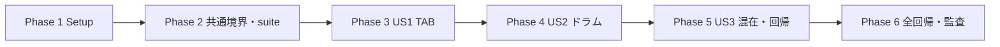

# Tasks: TAB譜・ドラム譜の取り込みと描画

**Input**: specs/009-tab-drum-notation/

**Prerequisites**: [spec.md](spec.md)、[plan.md](plan.md)、[research.md](research.md)、[data-model.md](data-model.md)、[記譜契約](contracts/notation.md)、[fixtures契約](contracts/fixtures.md)、[検証手順](quickstart.md)。憲章v1.3.0に従う。

**Tests**: 利用者と仕様が細粒度fixtures・対照・回帰検証を要求しているため、テスト作成を含む。各phaseの先頭テストを先に作り対象挙動が未実装で失敗することを確認する。文書生成段階ではアプリコード・テストを実行しない。

**Organization**: US1=P1 TAB、US2=P1 ドラム、US3=P2 混在と回帰。3ストーリーは今回すべて必須。MVPはUS1の最初の提供単位であり、他のストーリーの省略ではない。

## Format and Paths

`- [ ] Tnnn [P?] [USn?] 説明とファイルパス`。すべてリポジトリルート相対。新規ファイル名も本書で固定する。[P]はphase開始条件を満たした後、他の[P]と別ファイルで並行できるテスト作成を示す。テスト実行には対象実装が必要。

## Phase 1: Setup

**Goal**: 対象・検証条件を固定する。

**Independent Test / Gate**: 既存008の未検証を保持し、009を独立して実行・記録できる準備がある。

- [X] T001 specs/009-tab-drum-notation/investigation.md と specs/009-tab-drum-notation/quickstart.md に現状と実行環境を確認・記録する。Node22、既存依存、Prisma生成・worker・Bravura、DB検証保留と008の未完了証跡を区別し、新依存・DB migration・ブランチ切替を追加しない。

- [X] T002 specs/009-tab-drum-notation/coverage.md に FR-001–017、SC-001–006、US1/AC1–5・US2/AC1–4・US3/AC1–3 の追跡表を用意し、contracts/fixtures.md の独立条件を列挙する。未作成・未実施を合格にせず、実装前の同一入力・環境・配置の性能比較用条件を specs/009-tab-drum-notation/validation.md に記録する。

**Checkpoint**: 実装・自動結果・実保存取得・目視を別々に記録する。DB保留や未確認をpassにせず、環境に依存しない後続実装は進める。

## Phase 2: Foundational — 表記・無音高・検証基盤

**Goal**: 全ストーリーで共有する境界と描画・演奏の分離を用意する。

**Independent Test / Gate**: 旧数値音高と旧数値付き休符は維持し、完全候補のTAB／打楽器打音と打楽器休符はnullを保持できる。不完全候補の通常音高不明もnullとして保持する。suite・段階別判定は旧形式と互換である。

- [X] T003 [P] src/s-core/models/sheet/notation/staff-settings.test.ts に設定・新表記の境界テストを追加する。「kind: standard | tablature | percussion」「lineCount: integer」「対応TABは4/6線、percussionは5線」「tuningは弦番号一意、step A..G、octave -1..9、alter -2..2、結果0..127」、省略項目と旧fallbackを検証する。 完全／不完全候補のnull条件、percussion譜表上のrest:true/pitch:nullと旧数値休符、休符に打音表記・非空タイを付けた拒否を別々にテストする。

- [X] T004 [P] src/s-core/models/core/note.test.ts と src/s-core/models/core/score.test.ts に「pitch: 0..127 | null」の往復、有音高なしのkeyRange=null、旧数値Coreの挙動を検証するテストを追加する。通常JSONの数値音高必須を維持する。

- [X] T005 [P] src/s-core/models/sheet/notation/capabilities.test.ts に canRender/canPlayback/canPractice/canGame と reasons の契約テストを追加する。完全表記・音高nullは表示可、partialは表示不可、percussion・非休符の音高nullがあるTAB・曖昧併記は全演奏機能不可、通常譜は従来のblocker判定を維持する。

- [X] T006 [P] scripts/lib/notation-report.test.ts と src/app/dev/load-score-fixtures.test.ts に suite=notation/tab-drum、既定notation、不正suite拒否、保存先分離、実行段階の欠落・破損・失効・最新fail優先を検証するテストを追加する。src/s-core/models/fixtures/manifest.test.ts に旧selector互換と新selectorの境界を追加する。

- [X] T007 src/s-core/models/sheet/notation/staff-settings.ts と src/s-core/models/sheet/notation/schema.ts に共通Zodと型を実装する。「tablature?: { string: integer 1..6, fret: integer 0..36 }」「percussion?: { displayStep: A..G, displayOctave: integer -1..9, notehead: normal | x, instrumentId?: nonempty string max200, midiNote?: integer0..127, midiChannel?: integer0..15 }」「performanceEventId?: nonempty string max200」を定義する。TABとpercussion同時指定禁止、percussionとnotatedPitch/explicitAccidentalの併用禁止を検証する。 休符はrestで識別し、打音用tablature/percussion・音名・臨時記号・共有イベント・非空タイを付けない。任意sourceNotationは非実行JSON、UTF-8 JSON長64KiB/楽譜以下として境界検証し、完全／不完全候補とSheet往復で保持する。

- [X] T008 src/s-core/models/import/score-schema.ts と src/s-core/models/import/contracts.ts に新表記とstaffSettingsを完全／不完全候補へ通す。完全／不完全候補を別条件で検証し、譜表kind一致・参照identity trackId/barId/staveId・弦数以下・同時刻同一track/stave/stringの異なるfret拒否・明示tuning/fret/pitchの整合性をscore単位で検証する。 完全候補は通常非休符の数値音高を要求するが、完全TAB／percussion打音とpercussion譜表上の休符にはnullを許可する。不完全候補の通常音符は音高null、開始／音価不明を保持し、完全候補の数値必須制約を適用しない。休符nullの許可は所属譜表で判定し打音用percussion表記を要求しない。旧数値付き休符を維持する。

- [X] T009 src/s-core/models/core/note.ts と src/s-core/models/core/score.ts でインスタンスpitchを「MidiNoteNumber | null」に拡張し、serialize/importでnullを保持する。有音高なしのkeyRangeはnull、通常Core create/JSONの数値入力は維持する。src/s-core/models/sheet/note.ts と src/s-core/models/sheet/stave.ts のconstructor/export/importで新任意表記を保持し、旧値にdefaultを書き戻さない。 打楽器休符のnullは打音表記なしで往復し、休符判定はrestを使う。sourceNotationの原入力情報を保持する。

- [X] T010 src/s-core/models/sheet/notation/capabilities.ts に純粋な可否導出を実装し、src/s-core/models/import/diagnostics.ts と src/server/revision-validation.ts に接続する。reasonsは「[{ code, track?, bar?, fieldPath?, message }]」、永続revisionValidationは「validatorVersion/canPractice/canGame/unresolvedIssueIdsのみ維持」。表示可能なnullをMISSING_PITCH扱いせず、ドラム含有譜は演奏全体不可とし一部だけ黙って演奏しない。 休符のnullを発音音高不明やMISSING_PITCHと扱わない。未対応奏法が演奏結果へ影響する場合は演奏不可理由を出す。

- [X] T011 src/s-core/models/sheet/extensions/to-audio.ts、src/s-core/models/core/extensions/to-audio.ts、src/s-core/models/audio/note.ts、src/s-core/models/practice/timeline.ts、src/server/practice.ts にcapabilitiesとnullの入口・内部ガードを追加する。音声への架空音高補完を禁止し、鍵盤範囲の空状態を扱う。src/s-core/models/sheet/notation/accidentals.ts と src/s-core/models/core/extensions/generate-beams.ts などnullable化で影響する消費箇所を監査し、通常音符以外で音名推定を呼ばない。 休符を除外してから発音用pitchを検証し、null休符の発音・打鍵要求が0であることを保証する。

- [X] T012 src/s-core/models/fixtures/manifest.ts、src/s-core/models/fixtures/evaluate.ts、src/s-core/models/document/element.ts、src/s-core/models/document/element.ts（既存Group定義）、src/s-core/models/document/extensions/to-svg.ts に tabValue/string/fret/anchorRole とnote-anchorのmetadataを追加する。旧6段階・expectedOutcome/requiredStages/rejectionStage・selectorの契約を維持し、数字列の実体と世界座標を評価可能にする。 expectedOutcome=partialを追加し、import/roundtrip/persistedの既知値・元情報・診断を評価する。partialのdocument/svg/visualは非適用、rejectionStageは禁止し、既存render/rejectとの後方互換をテストする。

- [X] T013 scripts/lib/notation-report.ts と scripts/verify-notation-fixtures.ts に既知suite設定を追加する。notationは008、tab-drumは009のmanifest/report/unit/integration testへ解決し、「--suite notation|tab-drum、省略はnotation」、--persistedを維持する。allowlist外・欠けた引数を拒否し、各reportを原子的に更新、失敗時非0終了、通常npm testで暗黙更新しない。fingerprintは未コミット描画ソース・フォントを含める。

- [X] T014 src/app/dev/load-score-fixtures.ts、src/app/dev/notation/fixtures/page.tsx、src/components/score-fixture-gallery.tsx をsuite対応にする。manifest入力のrealpath制限、結果identity一致、reportエラー、全ページ・requiredStages・reject非適用を維持し、production非公開、旧Core/MXL routeとnotation既定値を回帰する。009のfixture未作成中は空manifestで検証し、US1で実入力を登録する。 partialを期待どおり保持した結果と描画非適用を区別し、converterの例外や描画を強制しない。

- [X] T015 src/s-core/models/import/score-schema.test.ts と src/s-core/models/sheet/notation/roundtrip.test.ts に新表記の完全／不完全往復・不正相互参照と旧Sheetを検証するテストを追加・実行する。src/s-core/models/audio/note.test.ts と src/s-core/models/practice/timeline.test.ts でnull直接変換拒否と既存通常譜維持を確認し、基盤テスト・型検査の結果を specs/009-tab-drum-notation/validation.md に記録する。 通常音符の音高nullが完全候補では拒否・不完全候補では保持されること、打楽器休符nullの読み込みと旧数値付き休符の往復を独立検証する。

**Checkpoint**: 実装・自動結果・実保存取得・目視を別々に記録する。DB保留や未確認をpassにせず、環境に依存しない後続実装は進める。

## Phase 3: User Story 1 — TAB譜の弦とフレットを読む (P1, MVP)

**Goal**: 6弦ギター・4弦ベースのTABを情報保持から表示まで通す。

**Independent Test / Gate**: 各弦のフレット0と2桁の数字が指定位置に出て譜線が貫通せず、実保存取得後も運指と数値音高が一致する。演奏不可TABでも描画できる。

- [X] T016 [P] [US1] src/s-core/models/import/musicxml-tablature.test.ts に staff-details/staff-lines/staff-tuning とtechnical/string/fret、同音異運指、4版共通表現・MXL、pitch欠落・範囲外・矛盾・途中弦数変更のテストを追加し、実装前に失敗を確認する。

- [X] T017 [P] [US1] src/s-core/models/engraving/tablature.test.ts と src/s-core/models/browser/tablature-svg.test.ts に各弦・0/9/10/36、数字runの実幅・譜線抜き・不在条件・リズム・数字アンカーtieのテストを追加する。metadataだけ正常で文字が欠落／逆順／別弦の対照結果を不合格にする。

- [X] T018 [P] [US1] src/server/score-tab-drum.integration.test.ts にTABの convertScore→signPreview→saveImport→readScore→同一表記／document assertion、提案・merge・再取得と矛盾入力拒否／revision・Git公開位置不変のテストを用意する。DB実行は保留し、JSON往復で実保存を代替しない。

- [X] T019 [US1] src/s-core/models/import/musicxml.ts でTABの譜表設定・TAB clef・technical string/fretを抽出し、staff-details number別の有効設定を後続小節へ展開する。tuningの最下線→低音弦とstring=1最上段の対応を反転して保持し、標準調弦・運指を捏造しない。未対応弦数／奏法、範囲外、明示音高矛盾は箇所と影響を診断し元情報を残す。 contracts/notation.mdの入力条件表に従い、未対応奏法のみは基本表記のrender＋省略警告＋sourceNotation保持、未対応弦数・必須表示情報欠落は描画不可の保存可能partialとし、JSON不整合のrejectと混同しない。

- [X] T020 [US1] src/s-core/models/import/promote-partial.ts と src/server/import-revalidate.ts を更新し、表記・時刻が完全なTABをpitch:nullでもSheetへ昇格する。notation付き／Core fallback両経路でstem/beamと新項目を保持し、nullを音高推定へ流さない。src/s-core/models/import/promote-partial.test.ts と src/server/import-revalidate.test.ts で修正後の保持・矛盾再評価を確認する。

- [X] T021 [US1] src/s-core/models/engraving/notation/staff-geometry.ts、src/s-core/models/sheet/notation/staff-settings.ts、src/s-core/models/sheet/stave.ts、src/s-core/models/engraving/stave.ts に譜表別の設定解決と座標変換を実装する。「height=lineCount-1」「TAB y=string-1」、4stringTabClef/6stringTabClefを線数で選び、旧track.staffDetails・clef fallbackを維持する。

- [X] T022 [US1] src/s-core/models/engraving/notation/tablature.ts にFretRunを実装する。同梱timeSig0..9を桁順に構成し「初期scale=0.6、桁間隔0.05 staff space」、0..36の実inkBounds/advanceとnote-anchorを幅計算前に確定する。src/s-core/models/engraving/note.ts と src/s-core/models/engraving/chord.ts に接続し、複数弦・数字と符幹・付点の幅を確保する。

- [X] T023 [US1] src/s-core/models/engraving/extensions/to-document.ts に role=tab-fret のGroupと実数字Glyph、value/string/fret/sourceを出力する。該当弦のrun inkBounds「＋0.15staff space」で線の交差区間をsort/mergeして分割し、背景色に依存せず譜線の貫通を防ぐ。通常TAB符頭・音高由来加線・調号／臨時記号の不在を保証する。

- [X] T024 [US1] src/s-core/models/engraving/geometry.ts、src/s-core/models/engraving/note.ts、src/s-core/models/engraving/chord.ts、src/s-core/models/engraving/extensions/to-document.ts で上下stem/flag、beam/hook、付点と各5音価・休符をTAB geometryへ接続する。数字run境界から符幹を出し、元の音価と数字を変更せず繰り返しdrawで要素を増殖させない。

- [X] T025 [US1] src/s-core/models/sheet/notation/ties.ts と src/s-core/models/engraving/notation/ties.ts でglyph名検索を明示note-anchorへ置き換える。TABはtrack/stave/voice/string/fretとnumberを区別してnull音高でも視覚タイを解決し、数字全体の端点からcomplete/outgoing/incomingを生成する。演奏ties意味を新設せず通常譜を回帰する。

- [X] T026 [US1] src/s-core/models/browser/evaluate-fixture-svg.ts と src/s-core/models/fixtures/evaluate.ts に実Glyph列からのTAB値・弦位置・数字境界・譜線交差とtieアンカーの意味的判定を追加する。src/s-core/models/fixtures/evaluate.test.ts で欠落、逆順、誤値、移動、不要符頭、譜線貫通、誤接続を条件ごとに検出する。

- [X] T027 [US1] src/s-core/fixtures/tab-drum/tab/ に6弦各6件・4弦各4件、0・1桁・2桁・36、同音異運指・複数弦・明示tuning・tuningなし・pitchなしの独立最小入力を追加する。src/s-core/fixtures/tab-drum/manifest.json に1主条件・由来・FR/US参照、全6段階の保持／位置／数／不在条件とvisualChecklistを登録する。

- [X] T028 [US1] src/s-core/fixtures/tab-drum/tab/ と src/s-core/fixtures/tab-drum/manifest.json に各5音価と各5休符、付点、上下stem/flag、beam/前後hook、同小節／小節越え／改行／改ページtieを独立条件で追加する。固定layoutとsizeReasonを記録し、不正弦0/範囲超過・fret負/小数/37・同弦相反・tuning矛盾のimport診断とpersisted拒否は別fixtureにする。 入力条件表のrender/partial/rejectを別fixtureにし、未対応情報の保存後保持も期待値に含める。

- [X] T029 [US1] src/s-core/models/fixtures/tab-drum.test.ts にmanifest駆動のimport/roundtrip/document/svg評価と条件別対照結果を追加する。src/s-core/models/fixtures/prepare.ts と src/s-core/models/fixtures/timeline.ts で描画と演奏可否を分離し、音高なしTABを描画でき、timelineを無断生成しないことを確認する。 partial outcomeはpartial schema/JSON往復で評価し、保存後も元情報・診断が一致することを確認する。既存Sheet prepareを強制せず、適用外の描画を合格扱いしない。

- [X] T030 [US1] src/components/import-preview.tsx、src/components/show-score.tsx、src/app/score/[id]/page.tsx、src/server/score-reader.ts でcapabilitiesを導出・表示する。canRender=true/canPlayback=falseでもViewerを表示し、canPlay prop既定trueに依存せず内部可否とのANDでAudio生成を制御する。音高nullを「不明な通常音符」と誤表示せず、既存HeroUIを使う。

- [X] T031 [US1] src/components/import-preview.test.tsx と src/components/show-score.test.tsx にTABのプレビュー・保存後表示・演奏利用可否・空keyRange・cleanupを検証するテストを追加する。src/s-core/models/practice/timeline.test.ts と src/s-core/models/browser/audio/controller.test.ts で音高既知・単独TABの既存打鍵数／時刻を維持し、音高nullは直接呼出しも拒否する。

- [X] T032 [US1] scripts/verify-notation-fixtures.ts --suite tab-drum とUS1単体/SVG/UIテストを実行し、specs/009-tab-drum-notation/verification-results.json と validation.md に実行結果を記録する。専用DB未実施のpersistedをpendingのまま維持する。

- [ ] T033 [US1] 実ブラウザーでUS1の全正常fixturesと取り込みpreviewを確認し、specs/009-tab-drum-notation/visual-results.json にvisualChecklist単位の結果とbrowser/reviewer・sourceHash/expectationHash/layout/rendererRevision/executedAtを記録する。各弦・2桁・譜線抜き・背景変更・リズム・全ページtieを確認し、未実施や利用者申告の範囲不明を合格にしない。

**Checkpoint**: 実装・自動結果・実保存取得・目視を別々に記録する。DB保留や未確認をpassにせず、環境に依存しない後続実装は進める。

## Phase 4: User Story 2 — ドラム譜の楽器とリズムを読む (P1)

**Goal**: 無音高の表示位置・符頭・楽器識別を保持して描画する。

**Independent Test / Gate**: スネア通常符頭とハイハット×を別入力で保存後も同じ位置に表示し、演奏対応不明でも表示できる。ドラムは今回演奏不可と理由を示す。

- [X] T034 [P] [US2] src/s-core/models/import/musicxml-percussion.test.ts にunpitched位置・notehead・instrument参照とpart-list対応、4版・MXL、未知参照・未対応符頭／奏法・位置欠落を検証するテストを追加する。midi-unpitched1/128→0/127、channel1/16→0/15と範囲外を検証する。 打楽器休符がpitch:null・打音用表記なしで各音価を取り込めることを追加検証する。

- [X] T035 [P] [US2] src/s-core/models/engraving/percussion.test.ts と src/s-core/models/browser/percussion-svg.test.ts に明示位置、normal whole/half/black、x whole/half/black、加線、各リズム・複数声部・同時打音・不要調号／臨時記号不在と誤符頭／誤位置の対照テストを追加する。

- [X] T036 [US2] src/server/score-tab-drum.integration.test.ts にドラム全正常manifestの保存・取得後の表記／document assertion、提案・merge・再取得とnull保持のテストを追加する。表示位置変更でinstrumentId/midiNote/midiChannelが変わらず、validation投影で演奏不可が保持されることを検証する。DB実行は保留する。 partial outcomeは元情報・診断・既知値を保存取得し、休符nullの全条件はSheetとして同じ描画assertionを実行する。

- [X] T037 [US2] src/s-core/models/import/musicxml.ts でunpitched/display-step/display-octave、notehead、instrument参照、score-instrument/midi-instrumentを抽出する。外部「midi-unpitchedの1..128を内部midiNote0..127へ」「MIDI channel1..16を0..15へ」境界で1回変換する。原譜位置を優先し、未指定noteheadのみnormalとし、不明参照・未対応明示値の理由と影響を返す。

- [X] T038 [US2] src/s-core/models/import/promote-partial.ts、src/s-core/models/import/diagnostics.ts、src/server/import-revalidate.ts で表示位置・時刻が完全な無音高打楽器のSheet昇格と診断再計算を実装する。音高なしを通常MISSING_PITCHにせず、位置欠落はpartialのまま元情報を保持する。pitch修正で演奏楽器を暗黙変更せず、表示制限と演奏不可を別理由にする。 打楽器休符はrest:true、所属譜表と時刻・音価・声部が完全なら打音位置なしでSheetへ昇格する。未対応符頭・必須打音位置欠落はpartialに保持して描画不可、未対応奏法のみは基本表記render＋警告と元情報保持とする。

- [X] T039 [US2] src/s-core/models/sheet/note.ts、src/s-core/models/sheet/chord.ts、src/s-core/models/engraving/notation/staff-geometry.ts にpercussionの位置と加線を実装する。「E4が最下線、F5が最上線」を表示位置基準とし、演奏pitchを参照しない。通常の音名推定・臨時記号処理を呼ばず明示位置を尊重する。

- [X] T040 [US2] src/s-core/models/engraving/note.ts、src/s-core/models/engraving/stave.ts、src/s-core/models/engraving/geometry.ts、src/s-core/models/engraving/extensions/to-document.ts で打楽器clef、normal符頭とnoteheadXBlack/Half/Whole、位置由来の必要加線、stem/flag/beam/hook・付点・各休符・声部を描画する。不要調号／臨時記号を抑制し、通常譜・TABを回帰する。 打楽器休符はrestを優先して描画し、pitch:nullから打音符頭・楽器・tieを生成しない。

- [X] T041 [US2] src/s-core/fixtures/tab-drum/drums/ と src/s-core/fixtures/tab-drum/manifest.json にバスドラム・スネア・クローズドハイハット・ハイハットペダル・ハイ／ミッド／フロアタム・クラッシュ・ライドを1楽器1主条件で登録する。normal whole/half/black、x、表示位置変更で楽器不変、演奏対応不明でも表示を別fixtureとし、全6段階と期待する明示位置を記録する。

- [X] T042 [US2] src/s-core/fixtures/tab-drum/drums/ と src/s-core/fixtures/tab-drum/manifest.json に各5音価・各5休符・付点・上下stem/flag・beam/前後hook・複数声部・同時打音を独立登録する。不明楽器参照・未対応符頭／奏法・表示位置欠落・表記kind矛盾は診断と保存拒否の適用段階を分け、原入力の保持と対照結果を記録する。 各5休符はpercussion譜表上のrest:true/pitch:null、打音用表記なしの最小fixtureにし、旧数値付き休符の往復を別fixtureにする。打音表記・非空タイ付き休符の拒否と発音混入0を対照検証する。未対応符頭・表示位置欠落はexpectedOutcome=partial、未対応奏法のみはrender＋警告、不正保存入力はrejectとして入力条件表と一致させる。

- [X] T043 [US2] src/components/import-preview.tsx と src/components/show-score.tsx、src/app/score/[id]/practice/page.tsx で表示可・再生／練習／ゲーム不可を理由付きで示す。src/components/show-score.test.tsx と src/server/practice.test.ts に混在も含むドラム音声未生成・直接practice拒否を追加し、楽器対応既知でも今回のドラム演奏を有効にしない。

- [X] T044 [US2] US2の単体/SVG/UIテストと scripts/verify-notation-fixtures.ts --suite tab-drum を実行し、specs/009-tab-drum-notation/verification-results.json と validation.md にドラム結果を記録する。未知楽器参照でも表示できること、描画前後で原データが不変なことを確認する。

- [ ] T045 [US2] 実ブラウザーでUS2全正常fixturesの9楽器・通常／×符頭・位置・各リズム・声部・全ページを確認し、specs/009-tab-drum-notation/visual-results.json に対象版と確認者／環境付き結果を記録する。未実施persisted/visualをpassにしない。

**Checkpoint**: 実装・自動結果・実保存取得・目視を別々に記録する。DB保留や未確認をpassにせず、環境に依存しない後続実装は進める。

## Phase 5: User Story 3 — 複合譜面と細粒度の回帰 (P2)

**Goal**: 異種譜表をそろえて表示し、併記の演奏重複を防ぎ条件別に回帰確認する。

**Independent Test / Gate**: 通常＋TAB、通常＋ドラム、同一part通常＋TABで線数と音符位置が独立し、小節・拍がそろう。再配置・改ページでも欠落せず、誤描画を個別検出できる。

- [X] T046 [P] [US3] src/s-core/models/engraving/mixed-staves.test.ts と src/s-core/models/browser/mixed-staves-svg.test.ts に4/5/6線の順序、異高さtrack・staveの累積位置、冒頭clef幅が違う場合の拍整列、固定改行・改ページ・再配置不変の失敗テストを追加する。

- [X] T047 [P] [US3] src/s-core/models/sheet/notation/performance-events.test.ts に明示共有event、未知／不一致event、関連のない同音、曖昧併記を検証するテストを追加する。「同一track内」「同時刻・音高・音価一致」「一意な通常譜／TABの組」を満たす共有だけが1打鍵になり、元表示ノートを失わないことを検証する。

- [X] T048 [US3] src/s-core/models/sheet/stave.ts、src/s-core/models/sheet/track.ts、src/s-core/models/engraving/stave.ts と src/s-core/models/engraving/notation/staff-geometry.ts で自分の高さ×IDや現在track高さ加算を先行要素の累積へ変更する。src/s-core/models/sheet/slot.ts と src/s-core/models/engraving/extensions/to-document.ts で小節ヘッダー最大幅を共有し、4/5/6線混在の拍位置をそろえる。

- [X] T049 [US3] src/s-core/models/sheet/notation/performance-events.ts と src/s-core/models/import/score-schema.ts にperformanceEventIdの明示共有検証・非永続演奏射影を実装する。表示ノートは保持し、同時刻同音だけで推測結合しない。src/s-core/models/sheet/notation/capabilities.ts で共有根拠のない通常譜＋TAB併記を演奏不可とし、未知／不一致共有IDは保存拒否する。

- [X] T050 [US3] src/s-core/models/sheet/extensions/to-audio.ts と src/s-core/models/practice/timeline.ts に明示共有イベントの1件化を接続する。src/s-core/models/practice/timeline.test.ts と src/s-core/models/practice/game-evaluation.test.ts で併記の余分な打鍵0、無関係なユニゾン維持、開始・音価・音高不変、曖昧併記の内部拒否を確認する。

- [X] T051 [US3] src/s-core/fixtures/tab-drum/mixed/ と src/s-core/fixtures/tab-drum/manifest.json に通常＋TAB、通常＋ドラム、3種混在、同一part通常＋TAB、4線／6線先行stave、異高さtrack先行、header共通位置、明示共有／曖昧併記を各1主条件で追加する。各種改行・改ページ・再layout条件は別入力にし固定寸法とsizeReasonを記録する。

- [X] T052 [US3] src/s-core/models/fixtures/coverage.test.ts と src/s-core/models/fixtures/tab-drum.test.ts に contracts/fixtures.md の全単独・混在条件と全12受け入れ条件の必須検査を追加する。正常fixtureの6段階と主条件を確認し、欠落・誤数字／弦・誤符頭／楽器位置・不要記号・譜線貫通・tie誤接続をそれぞれ検出する対照結果を必須にする。 partial outcomeの適用3段階と非適用描画を検査し、打楽器休符null・旧数値休符・通常音高不明partialの独立条件を必須化する。

- [X] T053 [US3] src/components/score-fixture-gallery.test.tsx と src/app/dev/load-score-fixtures.test.ts にsuite分離、全ページ・debug・再配置・cleanup、最新不合格、入力／期待値／描画ソース／フォント変更時の失効を追加する。src/app/dev/notation/fixtures/page.test.tsx でproduction非公開と008/009の選択・表示を回帰する。

- [X] T054 [US3] src/server/score-tab-drum.integration.test.ts に混在・同一part併記・共有イベントと旧資料の保存・取得・提案・merge・再取得テストを追加する。src/server/score-reader.test.ts で保存後DTOのcapabilitiesと既存validation形を確認し、旧認可・署名・改ざん・診断投影の検証を維持する。DB実行は保留する。

- [ ] T055 [US3] US3の単体/SVG/UIテストと両suite runnerを実行し、実ブラウザーで混在・同一part・改行・全ページ・debug／再配置を確認する。specs/009-tab-drum-notation/validation.md、verification-results.json、visual-results.json に実際に確認した範囲と版を記録する。008目視の旧合格を新描画版へ流用しない。

**Checkpoint**: 実装・自動結果・実保存取得・目視を別々に記録する。DB保留や未確認をpassにせず、環境に依存しない後続実装は進める。

## Phase 6: Polish & Cross-Cutting Concerns

**Goal**: 版互換・全回帰・証跡を監査し、未実施を残した正確な最終状態を記録する。

**Independent Test / Gate**: FR-001–017・SC-001–006に対応する全必須段階が満たされた時だけ全体完了とする。DB保留中は完了宣言しない。

- [X] T056 src/s-core/models/import/convert.ts と src/s-core/models/import/diagnostics.ts を新変換「converterVersion=score-import-v4」、再計算「validatorVersion=score-import-validation-v2」へ更新する。src/server/import-preview-token.test.ts と src/s-core/models/import/convert.test.ts で旧v1/v2/v3署名候補・旧validation受入れ、署名確認前に補完しないこと、新旧JSON/MIDIとworkerの互換性を確認する。 この版更新で途中の目視証跡が失効するため、T062の最終目視再確認を必須の後続依存とする。

- [X] T057 src/s-core/models/sheet/notation/roundtrip.test.ts、src/s-core/models/browser/score-svg.test.ts、src/s-core/models/practice/timeline.test.ts に旧Sheet/Core/MIDI、基礎記号・タイ・臨時記号、音楽情報・利用可否・原データ不変の横断回帰を追加・確認する。新nullable表現を旧クライアントへダウングレードできない制限を specs/009-tab-drum-notation/validation.md に記録する。

- [ ] T058 src/server/score-tab-drum.integration.test.ts と src/server/score-import.integration.test.ts、runner --suite tab-drum --persisted による実保存・取得・提案・merge・原子的拒否を検証する。今回は利用者指示によりDB実行を保留し、specs/009-tab-drum-notation/validation.md に未実施と後日の手順を残す。テスト作成完了と実行合格を区別し、この実行タスクを未実施のまま完了扱いにしない。

- [X] T059 specs/009-tab-drum-notation/quickstart.md の全回帰 npm test -- --run、npx tsc --noEmit、変更TS/TSX lint、npm run build を実行し、worker再生成を含む結果を validation.md に記録する。SMTP等の既存環境失敗と条件付き成功を区別する。両suiteの自動結果を最終ソース版で生成し、互いの保存先を上書きしないことを確認する。

- [X] T060 specs/009-tab-drum-notation/validation.md と benchmark-results.json に同一入力・実行環境・配置で既存通常譜／TAB／ドラム／混在の時間・要素数・幅・連続layoutを比較記録する。src/s-core/models/engraving/notation/tablature.ts と src/s-core/models/sheet/notation/performance-events.ts のMap・区間sort/mergeで全音対全音探索がないことを確認し、根拠のない性能閾値を追加しない。

- [X] T061 docs/development.md と specs/009-tab-drum-notation/quickstart.md、investigation.md を実装後の内容へ更新する。suite指定、1主条件fixture追加、由来・期待値・対照結果・sizeReason、表示と演奏制限、目視結果の版・確認者記録、DB保留を記載する。静的根拠と実行済み確認を区別する。

- [ ] T062 specs/009-tab-drum-notation/coverage.md にFR-001–017／SC-001–006／全12受け入れ条件→fixture/assertion/taskの最終対応を記録し、verification-results.json と visual-results.json の現在入力・期待値・layout・rendererRevisionを照合する。正常6段階とreject適用段階に従い未実施／失効を全体合格にせず、008の回帰結果も独立して確認する。 T056と全コード修正の完了後、T059で生成した最終ソースfingerprintを使い、失効した008/009両suiteの必須目視条件を実ブラウザーで再確認して各visual-results.jsonへ現在版の結果を記録する。T033/T045/T055は途中版の確認であり最終版の再確認を代替しない。目視未実施やDB保留なら監査は未完了として残す。

- [X] T063 specs/009-tab-drum-notation/validation.md に最終状態、実装済みと未検証の区別、DB・目視の残件、再生／練習／ゲーム制限、後続候補と次の $speckit-converge を記録する。未実施チェックを埋めず、全必須条件の証跡がそろうまで機能全体の完了を宣言しない。

**Checkpoint**: 実装・自動結果・実保存取得・目視を別々に記録する。DB保留や未確認をpassにせず、環境に依存しない後続実装は進める。

## Dependencies & Execution Order

- Phase 2は全ストーリーの前提。nullable化の型影響を解消してから描画を追加する。
- US1/US2の受け入れ入力は互いに依存しない。実装はimport/musicxml.ts、promote-partial.ts、engraving/note.ts、to-document.ts、manifest、統合テストを共有するためUS1→US2の順で行う。
- US3の混在と共有イベントはUS1/US2の描画とcapabilitiesを前提とする。共有イベントの演奏射影を変更したら関連US1演奏回帰も再実行する。
- phase内は先頭のテスト作成→モデル／境界→取り込み／解決→描画→fixture→UI／統合→自動・目視記録。前提が未実装のテスト作成以外は依存順に行う。
- suite基盤はUS1で最初のfixtureを登録するまで空manifestとテスト用入力で検証し、未作成のUS2/US3条件を合格にしない。全範囲の必須coverageはUS3で有効化する。
- DBテストは作成・型検査まで進め、実行は利用者の指示により保留。接続情報の再要求や既存DBへの代替接続はしない。DB/目視保留でも後続コードを進められるが、検証完了と全体完了のgateは満たさない。
- 最終版更新後は両suiteの自動記録を生成し直す。008の古い目視記録も失効規則に従い、現在版の成功に流用しない。

## Parallel Execution Examples

- US1: phase開始後、musicxml-tablature.test.ts、engraving/tablature.test.ts＋browser/tablature-svg.test.ts、score-tab-drum.integration.test.tsのテスト作成は別ファイルなので並行可能。manifest・import・描画の実装更新は順次行う。
- US2: musicxml-percussion.test.ts と engraving/percussion.test.ts＋browser/percussion-svg.test.tsのテスト作成を並行可能。US1と共通の統合テスト・実装・manifestは同時編集しない。
- US3: mixed-stavesのモデル／SVGテストとperformance-events.test.tsの作成を並行可能。配置修正と演奏射影のテスト実行は各実装後、全体結果の生成は最終ソース確定後に行う。

## Requirement Coverage

以下はタスク割当であり合格記録ではない。fixture/assertionの実IDはcoverage.mdに追加する。

| 要件 | 主なタスク |
| --- | --- |
| FR-001 | T008, T019, T021, T048 |
| FR-002 | T007, T019, T022, T027 |
| FR-003 | T003, T008, T016, T019, T027, T028 |
| FR-004 | T024, T025, T028, T042 |
| FR-005 | T023, T026, T052 |
| FR-006 | T040, T041, T045 |
| FR-007 | T009, T034, T037, T039 |
| FR-008 | T024, T028, T035, T042 |
| FR-009 | T005, T010, T011, T030, T038, T044, T049, T054 |
| FR-010 | T010, T031, T049 |
| FR-011 | T028, T046, T048, T051 |
| FR-012 | T015, T018, T036, T054, T056, T058 |
| FR-013 | T002, T027, T028, T041, T042, T051, T061, T062 |
| FR-014 | T012, T027, T041, T052, T062 |
| FR-015 | T017, T028, T029, T035, T042, T052, T061 |
| FR-016 | T006, T014, T053, T055, T062 |
| FR-017 | T015, T025, T044, T057 |
| SC-001 | T002, T052, T062 |
| SC-002 | T018, T036, T054, T058 |
| SC-003 | T032, T033, T044, T045, T055 |
| SC-004 | T017, T029, T035, T042, T049, T052, T061 |
| SC-005 | T015, T044, T050, T057 |
| SC-006 | T005, T010, T011, T030, T037, T038, T043, T049, T054 |

## Implementation Strategy

1. Setupと共通基盤を完成し、旧数値音高・旧schema・署名・routeを維持する。
2. US1で最小の「各弦のフレット0」から1桁・2桁、リズム・タイへ広げる。ここがMVP。保存の実検証が保留中なら制限を明記する。
3. US2で1打ずつの位置と符頭から複数声部・同時打音へ進める。表示可と演奏不可を同時に検証する。
4. US3で異種譜表の累積配置・拍整列・ページ境界、明示共有と曖昧併記を確認する。
5. 版更新・全回帰・両suiteの証跡・性能比較を終え、SC-001–006を監査する。未実施のDB・目視は未完了として残し、次に $speckit-converge で現行実装の残件を評価する。

## Notes

新endpoint・新ライブラリ・DB migration・運指生成・ドラム専用再生／採点は追加しない。生成MusicXML型やSMuFL定義を直接編集しない。今回はタスク生成のみ。既存008の仕様・タスク・未実施記録は変更しない。

## 承認済み解析修正

- I1: 完全／不完全候補のnull条件を分離。打楽器譜の休符もpitch:nullを許可し、rest判定・旧数値休符互換・発音除外をT003/T007–T011/T015/T034/T036/T038/T040/T042に反映。
- U1: 入力条件表と元情報保持を定義し、render/partial/rejectの期待結果をT012/T014/T019/T028/T029/T036/T038/T042/T052へ反映。
- C1: T056→T059→T062で最終ソース版の自動検証・失効した両suite目視再確認・監査の順を明記。
- タスクID・総数63件・ストーリー割当を維持する。DB実行保留を変更しない。

## 実行結果と未完了検証

全回帰839件、型検査、変更箇所lintは合格。buildは既存SMTP環境条件を切り分けた検証用プロセスで合格。自動結果は009の109件と008の69件を最終ソース版で生成し、両loaderの読込を確認した。詳細はvalidation.md。

T033/T045/T055は実ブラウザー目視、T058は利用者指示によりDB実行保留、T062はそれらの必須証跡待ち。該当タスクは未完了を維持する。チェックリストファイルは変更していない。

## Phase 7: Convergence

2026-10-20: 現在の仕様・計画・全63タスクとコードを照合。F1–F7を以下に追記する。既存タスクとチェック状態は変更しない。DB実行は利用者指示による保留を維持する。

- [X] T064 CRITICAL [F1] src/s-core/models/import/musicxml.ts でドラムの明示的な未対応表記を黙って通常表記へ落とさないようにする。再現入力はsnare.musicxmlのnoteheadにparentheses="yes"を追加したもの（現在はnormalへ変換され、警告もsourceNotationもない）。基本符頭を描画できる省略条件は対象箇所・表示への影響を診断し、元属性を非実行データとして保持する。未対応符頭そのものは従来のpartial規則を維持する。最小fixtureとimport/JSON往復/保存取得用assertionで括弧属性・診断・利用可否の保持を確認する。 per Constitution I, FR-009, spec: Assumptions（ゴーストノート括弧は省略診断対象）, T037 (contradicts)
- [X] T065 [F2] src/s-core/models/import/musicxml.ts と必要なpartialスキーマ・受け渡し経路で、未対応譜表の元staff-details・線数・調弦と所属箇所を保持する。tab/unsupported-stringsの現在出力はpartialになるが元のstaff-lines=7を失い、trackの旧5線設定とnoteの元情報だけが残る。無断で描画可能へ昇格させず、サイズ制限と入力検証を維持してimport・JSON往復・実保存取得用assertionに元譜表属性と診断を追加する。 per FR-001, FR-009, T019, plan: Design 2/6 (partial)
- [X] T066 [F3] src/s-core/fixtures/tab-drum/manifest.json と src/s-core/models/fixtures/fixture-suite-tests.ts の主条件検証を補強する。少なくともtab/same-pitch-different-fingeringとtab/simultaneous-stringsで2音目を含む各音の弦・フレット・位置・個数と音高／拍の関係をimport/roundtrip/persisted/document/svgの適用段階で検証する。現状は主にnotes.0とstring=1/fret=0だけの期待値で、2音目の欠落を直接判定できない。同時打音・声部など複数音が主条件のfixtureも同様に監査し、各対象の削除・数字／弦／位置／符頭の変更が対応assertionを失敗させる対照テストを追加する。 per FR-013, FR-014, FR-015, SC-001, SC-004, T027, T041, T052 (partial)
- [ ] T067 [F4] T058の実DB検証を未実施として維持し、利用者が後日専用の末尾_test PostgreSQLでの実行を許可・準備した時点で実施する。src/server/score-tab-drum.integration.test.ts と既存統合テスト、runner --suite tab-drum --persisted により正常／partialの実保存・取得・提案・merge、元表記・診断の保持、不正入力の原子的拒否を確認して現在版の結果を記録する。今回の保留中は既存DBへの代替接続や接続情報の再要求をせず、テスト作成やJSON往復で代替合格にしない。 per FR-012, SC-002, T058 (partial)
- [ ] T068 [F5] T064–T066/T069の修正と最終ソース版確定後、T033/T045/T055およびT062の実ブラウザー確認を実施する。008/009両suiteの必須正常条件についてBravuraの数字・符頭、譜線抜き、タイ、混在、全ページ、debug/再配置と取り込みpreviewを確認し、各visualChecklistに実際のbrowser/reviewer・入力/期待値hash・layout・rendererRevision・日時を記録する。実行環境がない間はpendingを維持し、SVG自動検証を目視合格にしない。 per SC-003, FR-016, T033, T045, T055, T062 (partial)
- [X] T069 [F6] src/s-core/models/import/musicxml-percussion.test.ts にmidi-unpitched=1/128→midiNote=0/127、midi-channel=1/16→0/15、および各範囲外を最小入力で追加し、境界で一度だけ変換することと不正値の診断／保持を確認する。src/s-core/fixtures/tab-drum/tab/ とmanifestに明示調弦・弦／fret・pitchの矛盾専用fixtureを追加し、MusicXMLのpartial診断・元情報保持と不正JSONのpersisted拒否を別条件で検証する。 per FR-003, FR-007, FR-009, T028, T034 (partial)
- [ ] T070 [F7] 全コード・fixture修正後に必要な回帰、型検査、lint、両suiteの自動検証を行い、coverage.md・validation.md・verification-results.jsonを現在の入力／期待値／layout／ソース版に更新する。T067/T068の実施状況と各必須段階を照合してT062の最終監査を完了する。DB保留または目視未実施ならその理由と次手順を残し、該当タスク・監査・機能全体を完了扱いしない。 per FR-016, SC-001–006, T059, T062, plan: Design 6 (partial)

依存順: T064/T065/T066/T069 → 最終版の自動検証（T070前半）→ T068 → T070最終監査。T067は利用者指示のDB保留解除後に実施し、それまでは最終監査を未完了として維持する。

### Phase 7 実行記録（2026-10-20）

T064/T065/T066/T069を完了。009は112 fixturesへ増加し、複数音の各対象だけを破壊する対照検証を追加した。全回帰850件・型検査・変更箇所lint・workerビルドが合格。両suiteの自動結果を生成し、全入力・期待値・layout・現在ソースfingerprintの一致を照合した。詳細はvalidation.mdの最新節を参照。

T067は利用者指示によりDB保留を維持。T068は実ブラウザー未実施。T070は自動検証部分を実施したが、DB・目視を含む最終監査は未完了のためチェックしない。既存のT033/T045/T055/T058/T062も未完了のまま。次は実ブラウザーによる両suiteとpreviewの確認・証跡記録を行い、DBは後日利用者が準備・許可した段階で実行する。

## Phase 8: Convergence

2026-10-20: 全70タスクを含め現在の実装を再照合。前回修正の関連テスト121件は合格。008/009の全fixtureで入力・期待値・layout・現在rendererRevisionの一致を確認し、既存自動証跡の失効は0件。以下は新しいコード修正1件と、既存の検証残件3件の引き継ぎであり、同じ検証の重複実行を要求しない。

利用者の目視申告: 使用ブラウザーはBrave、確認範囲は「だいたい全部見た」、不具合は「とくに不具合はない」。利用者による概略確認として記録する。fixture別の確認範囲、ブラウザー版、確認時のソース版・入力hash・期待値hash・layout・実行日時は未特定。008/009全件やpreview/debug/全ページの個別合格は推定せず、申告を未確認扱いで消さない。DB実行の保留指示は維持する。

- [X] T071 [F8] src/s-core/models/import/musicxml.ts で、ドラムの未対応奏法がtechnical以外に記載される場合も元情報を保持する。再現入力はdrums/snare.musicxmlのnote内へ <notations><ornaments><tremolo type="single">3</tremolo></ornaments></notations> を追加したもの。現状は完全SheetとDISPLAY_INFORMATION_OMITTED警告を返すがnote.sourceNotationがなく、ロール指定が保存候補から失われる。既存の省略警告・表示と演奏の分離を維持し、ロール自体の新規描画／再生は追加せず、対象箇所・影響と非実行の元奏法情報を保持する。仕様内の未対応ドラム奏法について同様の取りこぼしを確認し、最小fixtureでimport/JSON往復/Sheet往復・診断・利用可否・保存取得用assertionを追加する。既存64KiB合計制限を維持する。 per FR-009, SC-006, spec: Assumptions（ロール等は省略診断対象）, T037, T064 (partial)
- [ ] T072 [F9] T058/T067の実DB検証残件を引き継ぐ。利用者が後日専用の末尾_test PostgreSQLでの実行を許可・準備した時点で既存統合テストと両suiteの適用persisted検証を実施し、T071の元奏法情報を含む保存・取得・提案・merge・診断保持・不正入力の原子的拒否を現在版で確認する。現時点のDB実行保留を維持し、既存DBへの代替接続・接続情報の再要求・自動検証での代替合格を行わない。 per FR-012, SC-002, T058, T067 (partial)
- [ ] T073 [F10] T033/T045/T055/T068の目視証跡残件を引き継ぎ、validation.mdへ上記Braveの利用者申告を確認範囲不特定の概略確認として記録する。T071を含む最終ソース版で、実際に確認した008/009のfixture・visualChecklistとpreview/debug/全ページの範囲を特定できたものからbrowser/reviewer・入力/期待値hash・layout・rendererRevision・実行日時に対応付けて記録する。申告時点の未特定値や全件合格を捏造せず、未確認・失効をpendingで維持する。 per SC-003, FR-016, T033, T045, T055, T068 (partial)
- [ ] T074 [F11] T071完了後に関連回帰・型検査・lintと両suiteの自動証跡更新／版照合を行い、coverage.md・validation.md・verification-results.jsonを更新する。T062/T070の最終監査残件を引き継ぎ、Braveの利用者申告、自動合格、実DB未実施、fixture別目視の未確認を区別する。T072/T073で必要な証跡がそろうまで最終監査と機能全体を完了扱いにしない。 per FR-016, SC-001–006, T062, T070, plan: Design 6 (partial)

依存順: T071 → T074の自動検証部分 → T073の最終版確認 → T074の最終監査。利用者のBrave申告の記録は先行可能。T072は既存のDB保留解除後に実施する。今回のconvergeはtasks.mdの本節追加だけを行い、コード・既存タスク・仕様・計画・検証記録は変更していない。

### Phase 8 実行記録（2026-10-21 JST）

T071完了。technical以外の未対応ドラム奏法・装飾音を元情報付きで保持し、3つの最小fixturesを追加した。009は115件。全回帰857件・型検査・変更箇所lint・取り込みworkerビルドが合格し、両suiteの全自動証跡を現在入力・期待値・layout・rendererRevisionと照合した。詳細はvalidation.mdの最新節を参照。

T073のBraveによる「だいたい全部見た」「とくに不具合はない」という利用者申告をvalidation.mdへ記録した。個別fixtureの確認範囲と対象版は未特定のため、最終版の各visualChecklist合格とは扱わない。T072のDB保留、T073の個別目視証跡、T074の最終監査は未完了で、既存の対応する残件も未完了を維持する。T074の自動検証・証跡更新部分のみ完了。次は追加3条件の確認と実施範囲が特定できる目視記録を進め、DBは後日利用者が専用環境の実行を許可・準備した段階で行う。

### 追加3条件の確認申告（2026-10-21 JST）

追加3条件の確認案内に対し利用者から「問題ないように見える」と返答があった。T073の部分的な目視確認としてvalidation.mdへ記録した。追加3条件の再確認要求は不要。DB保留と全fixtureの形式的な証跡・最終監査の未完了は維持する。次は現状の実装・自動検証・利用者確認と残る検証制限をまとめてコードレビューへ進められる。

## Phase 9: Code Review Fixes

利用者の「やってくれ」に基づく、コードレビュー指摘3件の修正。以下は修正と自動回帰の完了を示し、既存の実DB・目視証跡・最終監査の未完了を変更しない。

- [X] T075 共有演奏イベントの代表を通常譜側へ統一し、配列順でタイの継続キーが変わらないようにする。performance-events.test.tsで複数の配列順、1秒の保持時間、継続元と音声代表IDを確認し、mixed/shared-tie-reorderedを追加する。 per review finding 1, FR-010, FR-017, SC-005
- [X] T076 明示的な通常音部記号への変更をstaffSettingsへ反映し、TAB／打楽器の設定・線数・調弦を誤継承しないようにする。drum/percussion-to-standardとtab/tab-to-standardで音高保持・JSON往復・G音部記号と復帰時の調号を確認する。 per review finding 2, FR-001, FR-003, FR-007, FR-010
- [X] T077 MusicXMLの音部記号を譜表番号別に保持し、一方の変更が他方へ混入しないようにする。mixed/independent-clef-changeで通常譜G→FとTABの保持を確認し、小節境界での音部記号変更を描画する。 per review finding 3, FR-001, FR-011

2026-10-21 JST: 全回帰865件、型検査、変更箇所lint、workerビルドが合格。009の119件・008の69件の自動証跡を更新し、全入力・期待値・layout・現在ソース版と一致することを確認した。詳細はvalidation.mdの最新節。DB保留・全件の目視証跡と最終監査は引き続き未完了で、同じ確認申告を再要求しない。

### 最終レビュー（2026-10-21 JST）

利用者の依頼により最終レビューを実施。追加のコミット阻害事項なし。全変更103ソースのlint、型検査、検証プロセスだけで既存SMTP設定を切り分けた本番buildが合格。全回帰865件と両suiteの現在版証跡を確認した。コードをコミットするが、DB保留・目視証跡・最終監査に関する既存の未完了タスクは変更しない。詳細はvalidation.md冒頭を参照。

### GitHub CIの保存統合テスト修正（2026-10-21 JST）

run 39535417425の3失敗を修正。不完全候補の昇格に失敗した場合の保存維持と、未指定楽器IDのundefined省略を実装した。3件のDB不要回帰を追加し、全877テスト・型検査・変更箇所lint・workerビルドが合格。ローカルDB保留を維持し、専用PostgreSQLを備えた既存ActionsでDB統合テストを再検証する。元の未完了チェック状態は変更しない。
